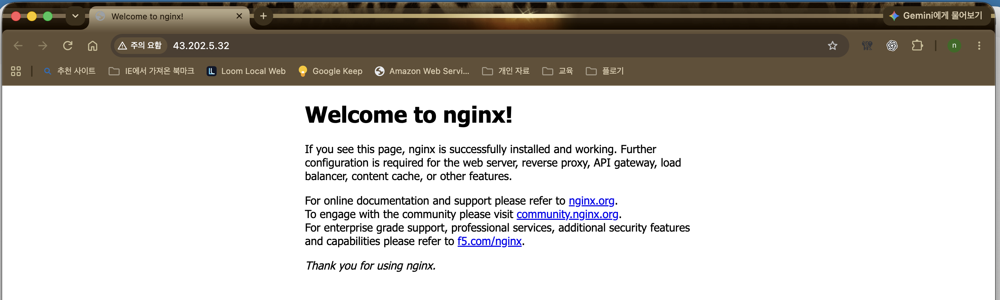
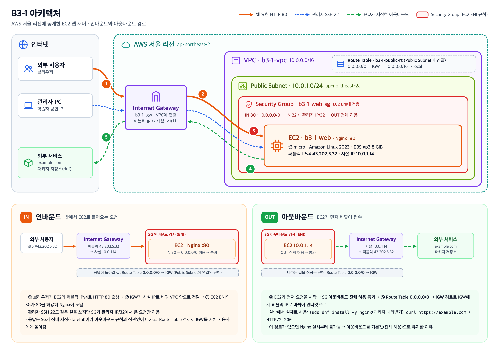
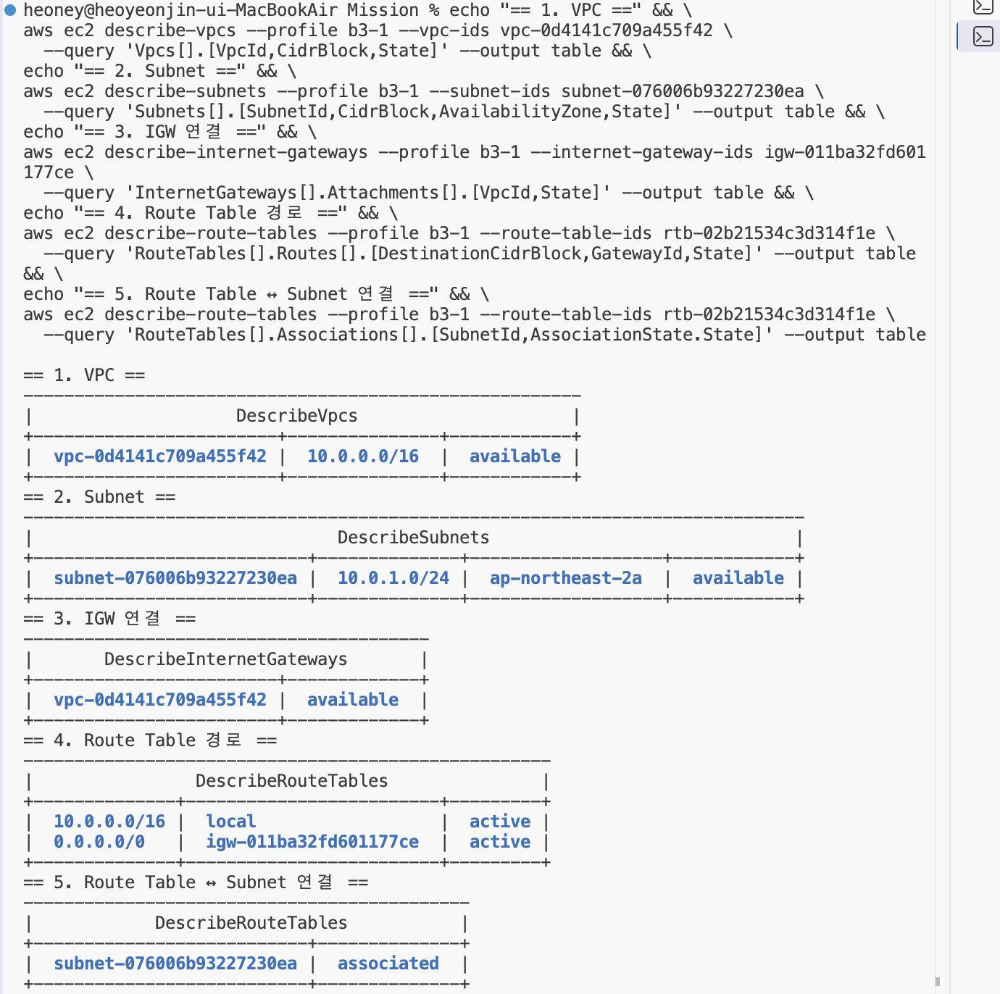
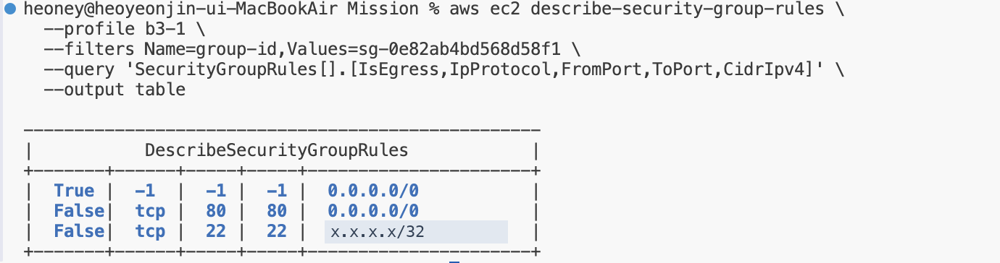
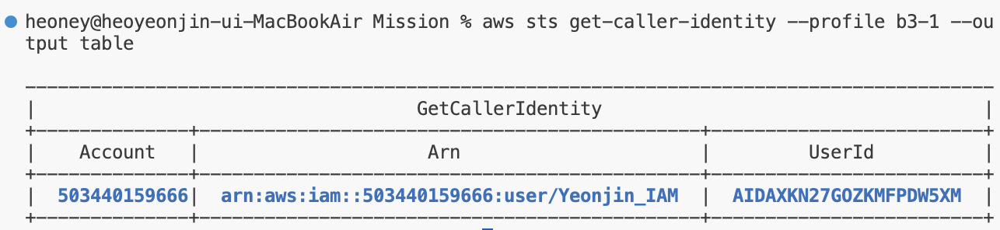
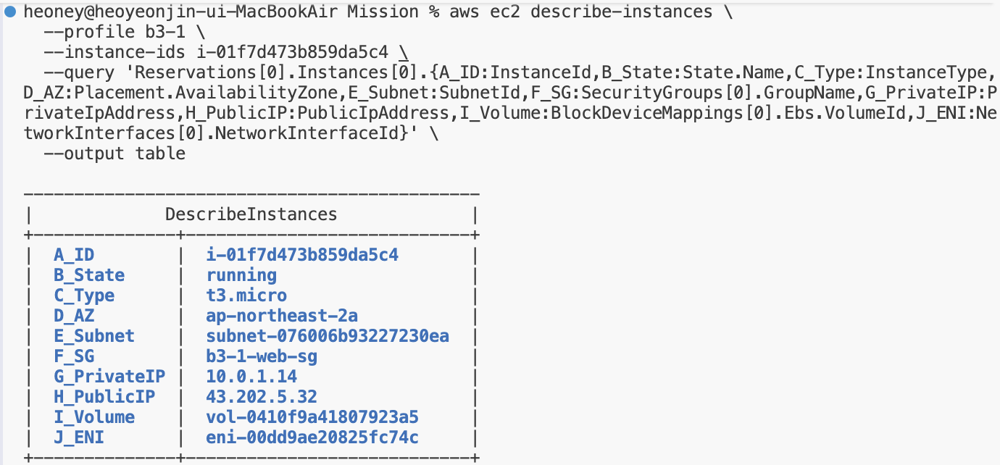
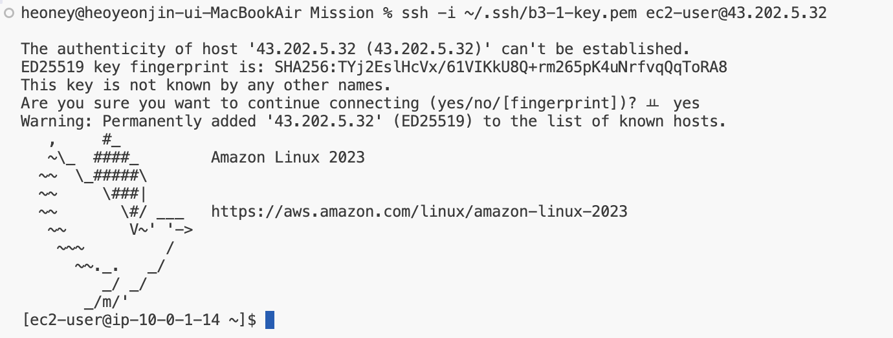
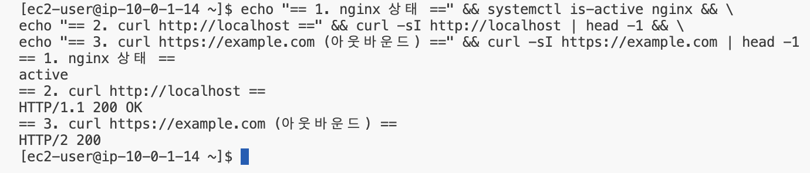

# B3-1 · AWS EC2에 웹 서버 공개하기

AWS 서울 리전(`ap-northeast-2`)에 VPC와 Public Subnet을 직접 구성하고, 그 안의 EC2에 Nginx 웹 서버를 실행해 인터넷에서 접속할 수 있게 만든 실습입니다. 모든 AWS 작업은 루트 계정이 아닌 IAM 사용자 `Yeonjin_IAM`으로 AWS CLI에서 수행했습니다.

## 외부 접속 검증

| 항목 | 내용 |
|---|---|
| 검증 방식 | **A. 브라우저에서 `http://<퍼블릭IP>` 접속** |
| 접속 주소 | `http://43.202.5.32` |
| 결과 | Nginx 기본 페이지(`Welcome to nginx!`) 정상 표시 |



> 브라우저 주소창의 "주의 요함"은 암호화되지 않은 HTTP로 접속했다는 표시입니다. 이 미션은 HTTP `80` 공개가 요구사항이며, HTTPS는 보너스 범위라 적용하지 않았습니다.
>
> 퍼블릭 IP는 EC2에 자동 할당된 주소(Elastic IP 아님)입니다. 실습 종료 후 리소스를 삭제하면 이 주소로는 더 이상 접속되지 않습니다.

## 트래픽 흐름

```text
외부 사용자(브라우저) ── http://43.202.5.32 (EC2 퍼블릭 IPv4)
  → 인터넷
  → Internet Gateway b3-1-igw   : 퍼블릭 IP 43.202.5.32 ↔ 사설 IP 10.0.1.14 변환
  → VPC b3-1-vpc (10.0.0.0/16)
  → Public Subnet b3-1-public-subnet (10.0.1.0/24, ap-northeast-2a)
       └ Route Table b3-1-public-rt: 0.0.0.0/0 → IGW, 10.0.0.0/16 → local
  → EC2 b3-1-web의 네트워크 인터페이스
       └ Security Group b3-1-web-sg 규칙 검사: 인바운드 HTTP 80 허용
  → Nginx(80번 포트)가 응답
```

EC2가 먼저 바깥에 접속하는 **아웃바운드**(패키지 설치 `dnf`, `curl https://example.com`)는 반대 방향으로 나갑니다.

```text
EC2 b3-1-web
  → Security Group 아웃바운드 규칙(전체 허용) 통과
  → Route Table 0.0.0.0/0 → IGW 경로
  → Internet Gateway: 사설 IP 10.0.1.14 → 퍼블릭 IP 43.202.5.32 변환
  → 인터넷 (example.com, 패키지 저장소)
```



Security Group은 트래픽이 거쳐 가는 별도 장비가 아니라 EC2 네트워크 인터페이스에 적용된 방화벽 규칙입니다. 요청 흐름 설명은 [docs/architecture.md](docs/architecture.md)에 있습니다.

## 구성 리소스

| 구분 | 이름 | 설정 |
|---|---|---|
| VPC | `b3-1-vpc` | `10.0.0.0/16` |
| Subnet | `b3-1-public-subnet` | `10.0.1.0/24`, `ap-northeast-2a` |
| Internet Gateway | `b3-1-igw` | VPC에 연결 |
| Route Table | `b3-1-public-rt` | `0.0.0.0/0 → IGW`, Public Subnet에 명시적 연결 |
| Security Group | `b3-1-web-sg` | 인바운드 HTTP `80` ← `0.0.0.0/0`, SSH `22` ← 학습자 개인 IP `/32`만 |
| EC2 | `b3-1-web` | `t3.micro`, Amazon Linux 2023, 퍼블릭 IP 자동 할당 |
| EBS | `b3-1-web-root` | gp3 8 GiB, EC2 종료 시 자동 삭제 |
| Key Pair | `b3-1-key` | ed25519, 개인키는 로컬에만 보관(저장소에 포함하지 않음) |

네트워크 구성 조회 결과(VPC, Subnet, IGW 연결, Route Table 경로와 Subnet 연결):



모든 리소스에는 정리 추적을 위해 `Project=Codyssey-B3-1`, `Owner=Yeonjin_IAM` 태그와 `b3-1-역할` 형식의 `Name` 태그를 붙였습니다.

### EC2 생성 방식

`run-instances` 한 번으로 미리 만든 부품을 가리켜 조립하고, 인스턴스와 함께 디스크·네트워크 카드가 새로 생깁니다.

```text
[이미 있음] AMI ─┐
[이미 있음] 서브넷 ─┤
[이미 있음] SG ─────┼──→ run-instances ──→ [새로 생김] EC2 인스턴스
[이미 있음] 키페어 ─┘                        ├─ [새로 생김] EBS 볼륨 (8GiB)
                                              └─ [새로 생김] ENI (사설 IP + 퍼블릭 IP)
```

## 보안 설정

- **Security Group 최소화**: 웹 서비스에 필요한 HTTP `80`만 전체 공개하고, 관리용 SSH `22`는 학습자 개인 IP 한 개(`/32`)로 제한했습니다. 그 밖의 인바운드 포트는 열지 않았습니다. 아웃바운드는 기본 규칙(전체 허용)을 유지해 패키지 설치와 외부 통신에 사용했습니다.
- **IAM 최소 권한**: 실습은 IAM 사용자 `Yeonjin_IAM` 하나로만 진행했습니다(그룹·인라인 정책 없음). 실습 리소스 권한은 고객 관리형 정책 `Codyssey_B3-1_Policy`가 담당합니다. 이 정책은 서울 리전의 EC2·VPC·Security Group 작업만 허용하고, 생성 시 `Project`·`Owner` 태그를 강제하며, `t3.micro`·gp3 8~10 GiB·AWS 공식 이미지로만 EC2를 만들 수 있게 제한합니다. 그 밖에 연결된 정책은 로컬 CLI 로그인(`aws login`)용 AWS 관리형 정책 `SignInLocalDevelopmentAccess` 하나입니다. `AdministratorAccess`와 S3·RDS 권한은 부여하지 않았습니다. 실습 중 모든 생성 작업이 이 범위 안에서 권한 오류 없이 수행되어, 추가 권한이 필요하지 않았음을 확인했습니다. 정책 전문: [`docs/iam-policy.json`](docs/iam-policy.json)




## 서버 내부 확인

| 확인 항목 | 결과 |
|---|---|
| EC2 상태 | `running`, `t3.micro`, Public Subnet, 퍼블릭 IP 할당 |
| SSH 접속 | `ssh -i ~/.ssh/b3-1-key.pem ec2-user@43.202.5.32` 성공 |
| 웹 서버 | `systemctl is-active nginx` → `active` |
| 내부 응답 | `curl -sI http://localhost` → `HTTP/1.1 200 OK` |
| 아웃바운드 | `curl -sI https://example.com` → `HTTP/2 200` |





## 제출 문서

| 문서 | 위치 |
|---|---|
| 아키텍처 다이어그램 | [`docs/architecture.png`](docs/architecture.png) (설명: [`docs/architecture.md`](docs/architecture.md)) |
| 트러블슈팅 | [`docs/troubleshooting.md`](docs/troubleshooting.md) |
| IAM 정책 (`Codyssey_B3-1_Policy`) | [`docs/iam-policy.json`](docs/iam-policy.json) |
| 평가항목별 증빙 모음 | [`docs/evaluation-evidence.md`](docs/evaluation-evidence.md) (문항 순서대로 캡처·실습 로그) |
| 리소스 정리 체크리스트 | [`docs/cleanup-checklist.md`](docs/cleanup-checklist.md) (정리 전·후 조회, 삭제 순서, 과금 위험 잔여 확인) |
