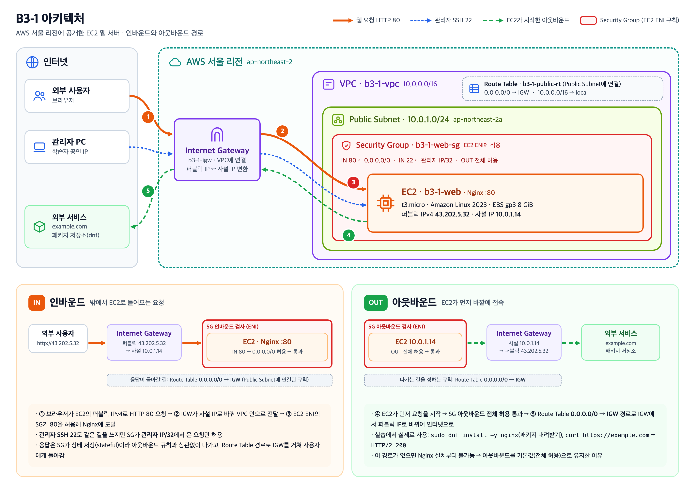
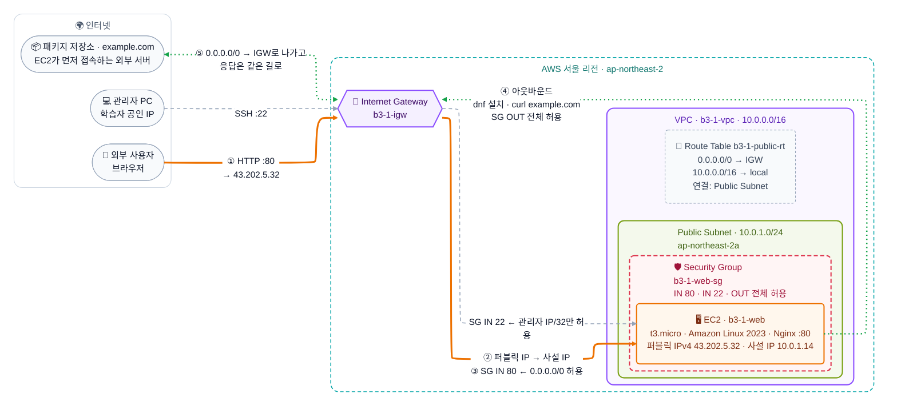

# B3-1 아키텍처

제출용 다이어그램: [`architecture.png`](architecture.png)

아래는 같은 구성을 텍스트로 관리하는 Mermaid 버전입니다.

## 범례

| 표시 | 의미 |
|---|---|
| 주황 굵은 선 | 외부 사용자의 웹 요청 경로 (HTTP 80, ①→②→③) |
| 회색 점선 | 관리자의 SSH 접속 경로 (22, 관리자 IP `/32`만 허용) |
| 초록 점선 | EC2가 **먼저 시작한** 아웃바운드 (④ `dnf` 패키지 설치, `curl https://example.com`). SG 아웃바운드 전체 허용 + Route Table `0.0.0.0/0 → IGW`로 나간다 (⑤) |
| 점선 테두리 카드 (Route Table) | 트래픽이 지나가는 장비가 아니라 Public Subnet에 연결된 경로 규칙표 |
| 빨간 점선 경계 (Security Group) | 트래픽이 거쳐 가는 별도 장비가 아니라 EC2의 네트워크 인터페이스(ENI)에 적용된 방화벽 규칙. 그래서 EC2를 감싸는 경계로 표시 |
| 영역 색 | 청록 점선 = 리전, 보라 = VPC, 초록 = Public Subnet (AWS 아키텍처 아이콘 색 기준) |

## 구성 정보

| 구성 요소 | 이름 | 주요 설정 |
|---|---|---|
| VPC | `b3-1-vpc` | `10.0.0.0/16` |
| Public Subnet | `b3-1-public-subnet` | `10.0.1.0/24`, `ap-northeast-2a` |
| Internet Gateway | `b3-1-igw` | VPC에 연결 |
| Route Table | `b3-1-public-rt` | `0.0.0.0/0 → IGW`, `10.0.0.0/16 → local`, Public Subnet에 연결 |
| Security Group | `b3-1-web-sg` | IN HTTP 80 ← `0.0.0.0/0`, IN SSH 22 ← 관리자 IP `/32`, OUT 전체 허용(기본) |
| EC2 | `b3-1-web` | `t3.micro`, Amazon Linux 2023, Nginx, 사설 `10.0.1.14`, 퍼블릭 `43.202.5.32` |

## 외부 요청 흐름

1. 외부 사용자가 브라우저로 EC2의 **퍼블릭 IPv4 주소** `http://43.202.5.32`에 HTTP 80 요청을 보낸다. EC2에 퍼블릭 IPv4가 없으면 인터넷에서 찾아갈 주소 자체가 없다.
2. 요청은 VPC에 연결된 **Internet Gateway**로 들어온다. IGW는 퍼블릭 IP `43.202.5.32`를 EC2 네트워크 인터페이스의 사설 IP `10.0.1.14`로 변환해 VPC 안으로 전달한다.
3. EC2가 있는 Subnet의 **Route Table**에 `0.0.0.0/0 → IGW` 경로가 있어, 이 Subnet은 인터넷과 주고받는 트래픽이 IGW를 통해 오가는 **Public Subnet**이다. 이 경로가 없으면 응답이 인터넷으로 나갈 수 없다.
4. 패킷이 EC2의 네트워크 인터페이스에 도착하면 그곳에 적용된 **Security Group** 규칙을 검사한다. 인바운드 HTTP 80(`0.0.0.0/0`)이 허용되어 있으므로 통과한다. Security Group은 상태 저장(stateful) 방식이라, 허용된 요청에 대한 응답은 별도 아웃바운드 규칙 없이 돌아간다.
5. **EC2의 Nginx**가 80번 포트에서 웹 페이지를 응답하고, 응답은 IGW에서 다시 퍼블릭 IP로 변환되어 사용자에게 돌아간다.

**아웃바운드(④·⑤)**: EC2가 먼저 바깥에 접속하는 통신(패키지 설치, `curl https://example.com`)은 SG의 **아웃바운드 규칙(전체 허용)**을 통과한 뒤 Route Table의 `0.0.0.0/0 → IGW` 경로로 인터넷에 나간다. 이것은 ③ 요청에 대한 **응답**과 다르다. 응답은 SG가 상태 저장 방식이라 아웃바운드 규칙과 상관없이 나간다.

관리자 SSH(22)도 같은 퍼블릭 IP와 IGW 경로를 쓰지만, Security Group이 학습자 공인 IP `/32` 한 곳에서 온 요청만 허용한다.

정리하면 외부에서 EC2에 접근하려면 **① 퍼블릭 IPv4 주소, ② VPC에 연결된 IGW, ③ Subnet Route Table의 `0.0.0.0/0 → IGW`, ④ 해당 포트를 허용하는 Security Group, ⑤ 그 포트에서 실행 중인 서버 프로세스(Nginx)**가 모두 필요하다. 하나라도 빠지면 접속되지 않는다.
