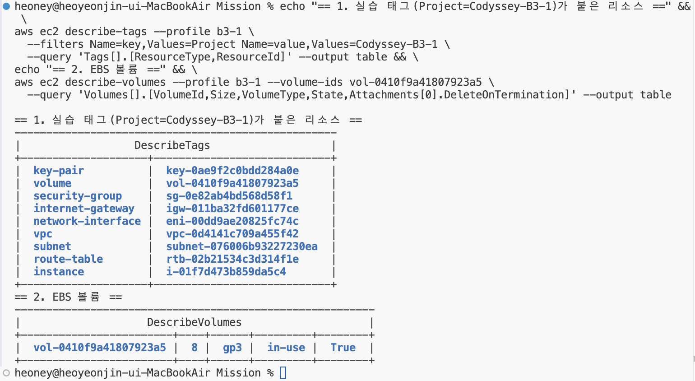
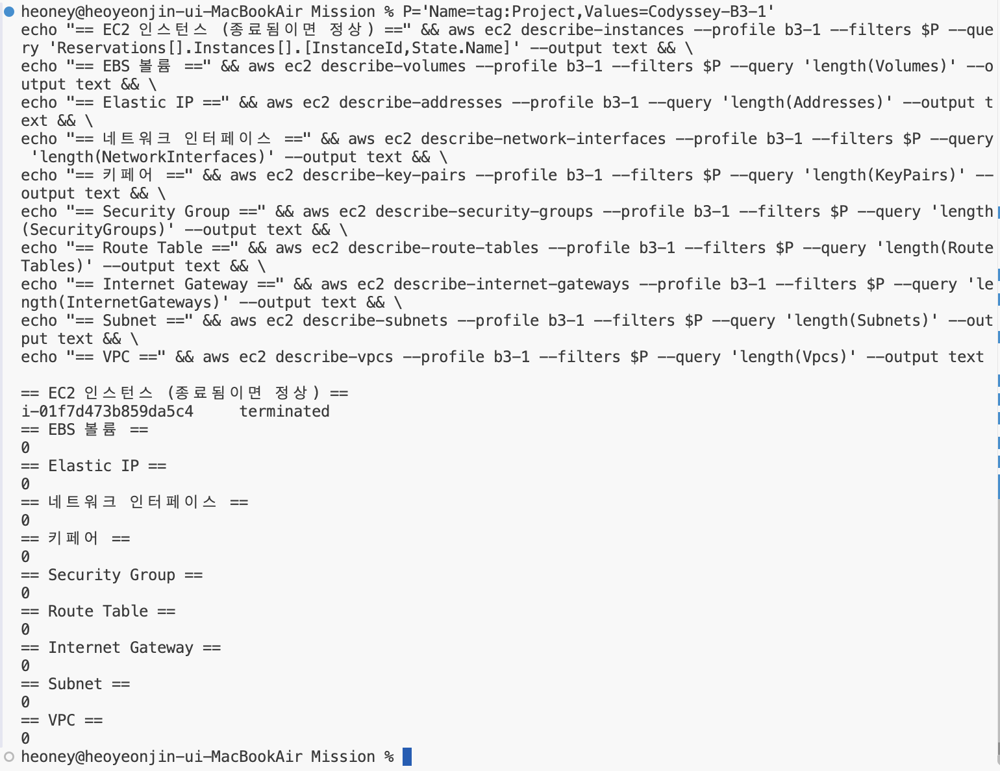
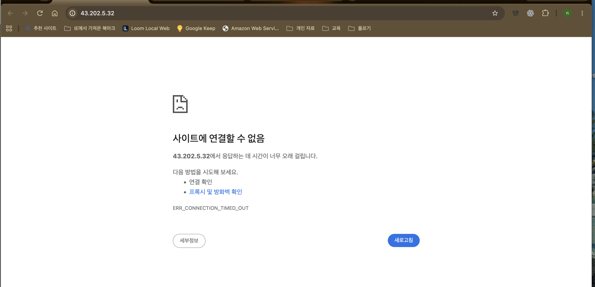

# B3-1 리소스 정리 체크리스트

실습 종료 후 서울 리전(`ap-northeast-2`)에 만든 리소스를 모두 삭제하고, 삭제 후 다시 조회해 남은 리소스와 과금 위험이 없음을 확인했습니다. 모든 작업은 IAM 사용자 `Yeonjin_IAM`(프로필 `b3-1`)으로 AWS CLI에서 수행했습니다.

- 정리 일시: 2026-11-10
- 추적 기준: 모든 실습 리소스에 `Project=Codyssey-B3-1`, `Owner=Yeonjin_IAM` 태그를 붙였습니다(IAM 정책이 태그 없는 생성을 거부). 정리 전후 모두 이 태그로 조회했습니다.

## 1. 정리 전 리소스 목록

태그 기준으로 실습 리소스 9개를 확인했습니다. EBS 볼륨은 `DeleteOnTermination=True`라 EC2와 함께 삭제되도록 생성 시 지정했습니다.

## 2. 삭제 순서와 결과

다른 리소스가 붙잡고 있으면 삭제가 거부되므로, 붙잡고 있는 쪽(EC2)부터 바탕이 되는 쪽(VPC) 순서로 삭제했습니다.

| 순서 | 리소스 | ID | 삭제 명령 | 결과 |
|---|---|---|---|---|
| 1 | EC2 인스턴스 `b3-1-web` | `i-01f7d473b859da5c4` | `terminate-instances` → `wait instance-terminated` | `running → shutting-down` → 종료 완료 |
| 1-a | EBS 볼륨 `b3-1-web-root` (8 GiB gp3) | `vol-0410f9a41807923a5` | EC2 종료 시 자동 삭제 (`DeleteOnTermination=True`) | 정리 후 조회 0개 |
| 1-b | 네트워크 인터페이스 `b3-1-web-eni` | `eni-00dd9ae20825fc74c` | EC2 종료 시 자동 삭제 | 정리 후 조회 0개 |
| 1-c | 퍼블릭 IPv4 `43.202.5.32` | (자동 할당, Elastic IP 아님) | EC2 종료 시 자동 반납 | 정리 후 외부 접속 불가 |
| 2 | 키페어 `b3-1-key` | `key-0ae9f2c0bdd284a0e` | `delete-key-pair` | `"Return": true` |
| 3 | Security Group `b3-1-web-sg` | `sg-0e82ab4bd568d58f1` | `delete-security-group` | `"Return": true` |
| 4 | Route Table `b3-1-public-rt` | `rtb-02b21534c3d314f1e` | `disassociate-route-table`(`rtbassoc-0fa8d7b66366482b8`) → `delete-route-table` | 성공(출력 없음) |
| 5 | Internet Gateway `b3-1-igw` | `igw-011ba32fd601177ce` | `detach-internet-gateway` → `delete-internet-gateway` | 성공(출력 없음) |
| 6 | Subnet `b3-1-public-subnet` | `subnet-076006b93227230ea` | `delete-subnet` | 성공(출력 없음) |
| 7 | VPC `b3-1-vpc` | `vpc-0d4141c709a455f42` | `delete-vpc` | 성공(출력 없음). VPC 기본 Route Table·기본 SG·기본 NACL도 함께 삭제 |

명령과 출력 원문은 [practice-session.log](practice-session.log)의 `## 12. 리소스 정리`에 있습니다.

## 3. 정리 후 확인

태그 `Project=Codyssey-B3-1`로 리소스 종류별 남은 개수를 다시 조회했습니다.

| 확인 항목 (미션 최소 5종 포함) | 정리 후 조회 결과 | 판단 |
|---|---|---|
| **EC2** | `i-01f7d473b859da5c4 terminated` | ✅ 종료됨. 종료된 인스턴스는 약 1시간 동안 목록에 남았다가 사라지며 과금되지 않음 |
| **EBS 볼륨** | 0 | ✅ 삭제됨 (미사용 볼륨 없음) |
| **Elastic IP** | 0 | ✅ 할당한 적 없음, 남은 주소 없음 |
| **Internet Gateway** | 0 | ✅ 분리·삭제됨 |
| **VPC** | 0 | ✅ 삭제됨 |
| 네트워크 인터페이스 | 0 | ✅ 삭제됨 |
| 키페어 | 0 | ✅ 삭제됨 |
| Security Group | 0 | ✅ 삭제됨 |
| Route Table | 0 | ✅ 삭제됨 |
| Subnet | 0 | ✅ 삭제됨 |

## 4. 과금 위험 항목 잔여 여부

| 과금 위험 항목 | 이번 실습 | 잔여 |
|---|---|---|
| 실행 중인 EC2 | 1대 생성 → 종료 | 없음 |
| EBS 볼륨·스냅샷 | 볼륨 1개 생성 → 자동 삭제, 스냅샷 생성 안 함 | 없음 |
| 퍼블릭 IPv4 / Elastic IP | 자동 할당 1개 → EC2 종료로 반납, EIP 할당 안 함 | 없음 |
| NAT Gateway | 생성 안 함 (실습 IAM 정책에 생성·조회 권한 자체가 없음) | 없음 |
| ELB / ALB | 생성 안 함 (실습 IAM 정책에 권한 없음) | 없음 |
| RDS | 생성 안 함 (실습 IAM 정책에 권한 없음) | 없음 |
| 다른 리전의 리소스 | 실습 IAM 정책이 서울 리전(`aws:RequestedRegion=ap-northeast-2`) 외 작업을 허용하지 않음 | 없음 |

정리 후 브라우저로 `http://43.202.5.32`에 접속하면 `ERR_CONNECTION_TIMED_OUT`(시간 초과)으로 연결되지 않습니다. 서버와 퍼블릭 IP, 네트워크 경로가 모두 사라졌기 때문입니다.

## 5. 로컬 정리

- 키페어 개인키 `~/.ssh/b3-1-key.pem`: AWS의 키페어(공개키)를 삭제해 더 이상 쓸 곳이 없어 로컬 파일도 삭제했습니다(`rm` 후 `ls`로 `No such file or directory` 확인).
- SSH 접속 기록: 반납한 퍼블릭 IP `43.202.5.32`는 다른 사용자에게 다시 배정될 수 있으므로 `ssh-keygen -R 43.202.5.32`로 `~/.ssh/known_hosts`의 서버 지문을 지웠습니다.
- Billing Dashboard 확인은 미션에서 권장 사항입니다. 실습 IAM 사용자에게는 Billing 권한이 없어 루트 계정으로 확인합니다.
