# B3-1 평가항목별 증빙

## 항목 1 · 구성 확인

### 1-1. VPC, Public Subnet, Internet Gateway, Route Table(0.0.0.0/0 → IGW)이 구성되어 있는가?

> **답변 요점** 예. 서울 리전에 VPC 10.0.0.0/16, Public Subnet 10.0.1.0/24(2a), VPC에 연결된 IGW, 0.0.0.0/0 → IGW 경로를 가진 Route Table을 만들고 Subnet에 연결했다. 최종 조회에서 모두 available·active·associated로 확인했다.

#### 증빙 캡처

**VPC·Subnet·IGW 연결·Route Table 경로·Subnet 연결 최종 조회**

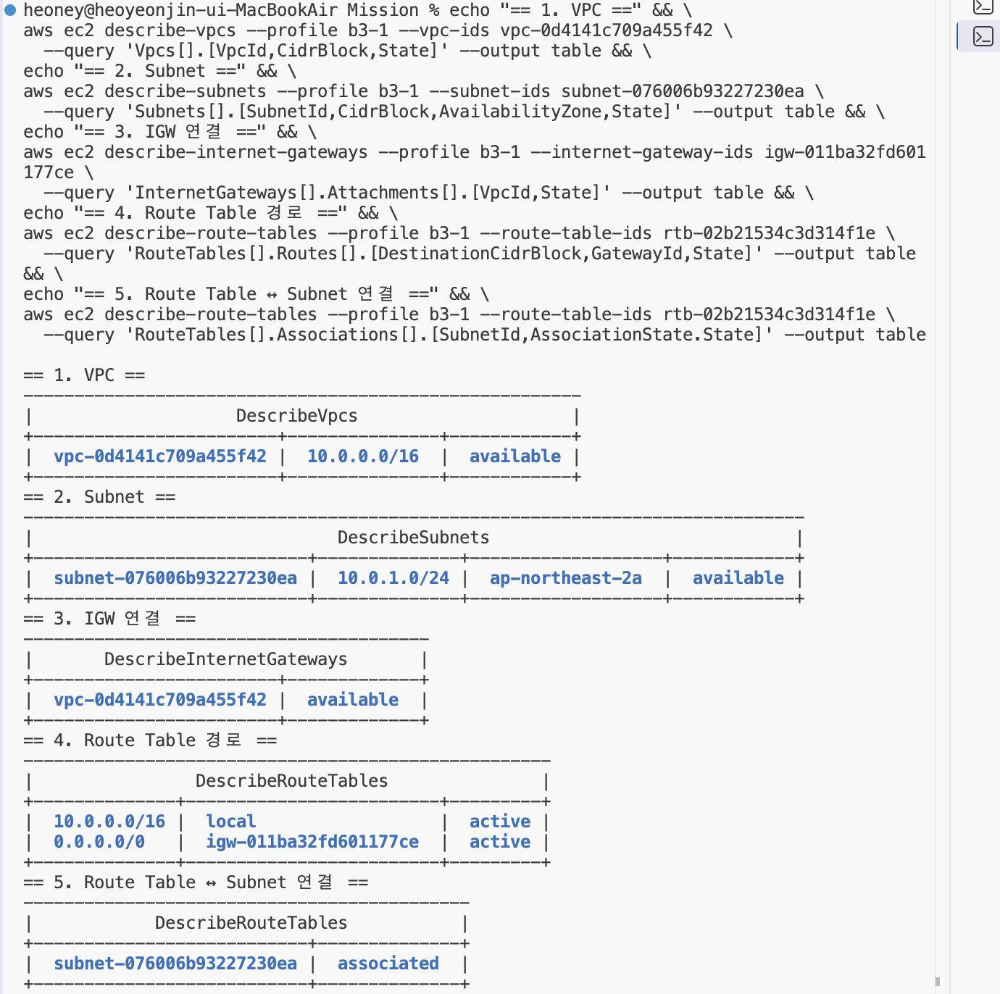

#### 실습 근거

**Public Subnet 생성** · [실습 로그](practice-session.log) 27–39행

```bash
$ aws ec2 create-subnet \
    --profile b3-1 \
    --vpc-id vpc-0d4141c709a455f42 \
    --cidr-block 10.0.1.0/24 \
    --availability-zone ap-northeast-2a \
    --tag-specifications 'ResourceType=subnet,Tags=[{Key=Name,Value=b3-1-public-subnet},{Key=Project,Value=Codyssey-B3-1},{Key=Owner,Value=Yeonjin_IAM}]' \
    --query 'Subnet.[SubnetId,CidrBlock,AvailabilityZone,State]' \
    --output table
|        CreateSubnet        |
|  subnet-076006b93227230ea  |
|  10.0.1.0/24               |
|  ap-northeast-2a           |
|  available                 |
```

**기본 경로 추가와 Subnet 연결** · [실습 로그](practice-session.log) 74–91행

```bash
$ aws ec2 create-route \
    --profile b3-1 \
    --route-table-id rtb-02b21534c3d314f1e \
    --destination-cidr-block 0.0.0.0/0 \
    --gateway-id igw-011ba32fd601177ce
{
    "Return": true
}
$ aws ec2 associate-route-table \
    --profile b3-1 \
    --route-table-id rtb-02b21534c3d314f1e \
    --subnet-id subnet-076006b93227230ea
{
    "AssociationId": "rtbassoc-0fa8d7b66366482b8",
    "AssociationState": {
        "State": "associated"
    }
}
```

**네트워크 최종 조회** · [실습 로그](practice-session.log) 222–238행

```bash
$ aws ec2 describe-vpcs --profile b3-1 --vpc-ids vpc-0d4141c709a455f42 \
    --query 'Vpcs[].[VpcId,CidrBlock,State]' --output table
|  vpc-0d4141c709a455f42 |  10.0.0.0/16  |  available |
$ aws ec2 describe-subnets --profile b3-1 --subnet-ids subnet-076006b93227230ea \
    --query 'Subnets[].[SubnetId,CidrBlock,AvailabilityZone,State]' --output table
|  subnet-076006b93227230ea |  10.0.1.0/24  |  ap-northeast-2a  |  available |
$ aws ec2 describe-internet-gateways --profile b3-1 --internet-gateway-ids igw-011ba32fd601177ce \
    --query 'InternetGateways[].Attachments[].[VpcId,State]' --output table
|  vpc-0d4141c709a455f42 |  available   |
$ aws ec2 describe-route-tables --profile b3-1 --route-table-ids rtb-02b21534c3d314f1e \
    --query 'RouteTables[].Routes[].[DestinationCidrBlock,GatewayId,State]' --output table
|  10.0.0.0/16 |  local                   |  active |
|  0.0.0.0/0   |  igw-011ba32fd601177ce   |  active |
$ aws ec2 describe-route-tables --profile b3-1 --route-table-ids rtb-02b21534c3d314f1e \
    --query 'RouteTables[].Associations[].[SubnetId,AssociationState.State]' --output table
|  subnet-076006b93227230ea |  associated  |
# 캡처: docs/screenshots/network-config1.png, docs/screenshots/network-config2.png
```


### 1-2. EC2에 SSH로 접속 가능하며, 웹 서버가 실행 중인가?

> **답변 요점** 예. ssh -i ~/.ssh/b3-1-key.pem ec2-user@43.202.5.32로 접속해 프롬프트가 [ec2-user@ip-10-0-1-14 ~]$로 바뀌었다. Nginx를 설치·실행해 systemctl is-active가 active, 서버 안 curl http://localhost가 HTTP/1.1 200 OK였다.

#### 증빙 캡처

**SSH 접속 성공 (프롬프트 ec2-user@ip-10-0-1-14)**

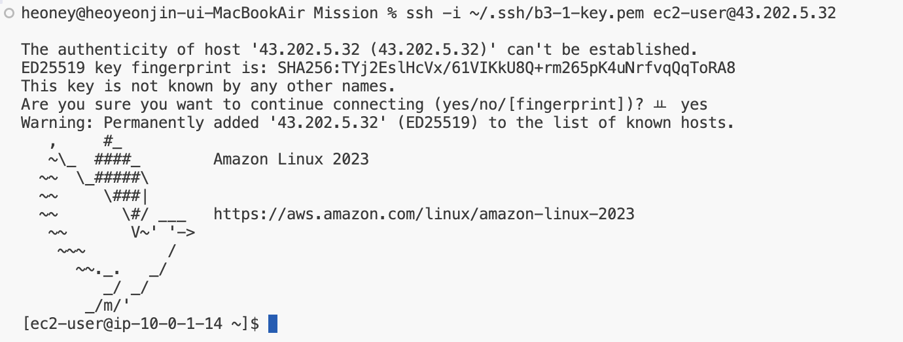

**Nginx active · localhost 200 · 아웃바운드 200**

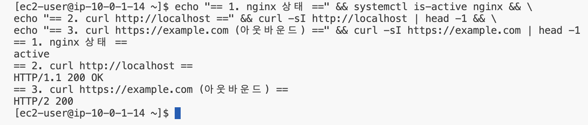

#### 실습 근거

**SSH 접속** · [실습 로그](practice-session.log) 193–198행

```bash
$ ssh -i ~/.ssh/b3-1-key.pem ec2-user@43.202.5.32
Are you sure you want to continue connecting (yes/no/[fingerprint])? yes
Warning: Permanently added '43.202.5.32' (ED25519) to the list of known hosts.
# (요약) Amazon Linux 2023 로고 배너 출력 후 EC2 프롬프트로 바뀜
[ec2-user@ip-10-0-1-14 ~]$
# 캡처: docs/screenshots/ssh-connected.png
```

**Nginx 설치와 실행** · [실습 로그](practice-session.log) 201–205행

```bash
[ec2-user@ip-10-0-1-14 ~]$ sudo dnf install -y nginx
# (보고) 설치 목록 출력 후 마지막 줄 Complete!
[ec2-user@ip-10-0-1-14 ~]$ sudo systemctl enable --now nginx
[ec2-user@ip-10-0-1-14 ~]$ systemctl is-active nginx
# (보고) active
```

**서버 내부 확인 3종** · [실습 로그](practice-session.log) 206–215행

```bash
[ec2-user@ip-10-0-1-14 ~]$ echo "== 1. nginx 상태 ==" && systemctl is-active nginx && \
echo "== 2. curl http://localhost ==" && curl -sI http://localhost | head -1 && \
echo "== 3. curl https://example.com (아웃바운드) ==" && curl -sI https://example.com | head -1
== 1. nginx 상태 ==
active
== 2. curl http://localhost ==
HTTP/1.1 200 OK
== 3. curl https://example.com (아웃바운드) ==
HTTP/2 200
# 캡처: docs/screenshots/server-local-check.png
```


### 1-3. 보안 그룹 인바운드가 필요 포트만 허용하며, SSH(22)가 특정 IP로 제한되어 있는가?

> **답변 요점** 예. b3-1-web-sg의 인바운드는 TCP 80 ← 0.0.0.0/0, TCP 22 ← x.x.x.x/32 두 줄뿐이다. 아웃바운드는 기본 전체 허용 1줄이며, 인바운드 전체 포트 공개 규칙은 없다.

#### 증빙 캡처

**Security Group 전체 규칙 3줄**

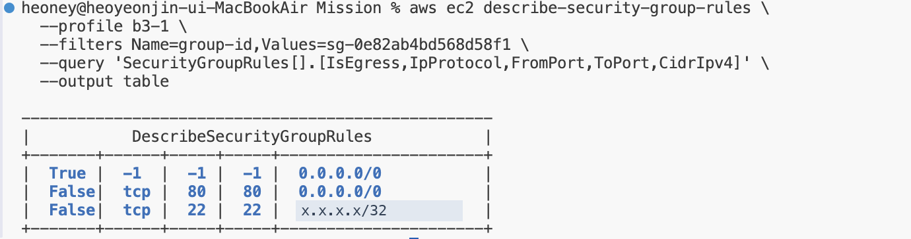

#### 실습 근거

**80과 22 인바운드 규칙 추가** · [실습 로그](practice-session.log) 105–118행

```bash
$ aws ec2 authorize-security-group-ingress \
    --profile b3-1 \
    --group-id sg-0e82ab4bd568d58f1 \
    --ip-permissions 'IpProtocol=tcp,FromPort=80,ToPort=80,IpRanges=[{CidrIp=0.0.0.0/0,Description="HTTP from anywhere"}]' \
    --query 'SecurityGroupRules[].[IsEgress,IpProtocol,FromPort,ToPort,CidrIpv4]' \
    --output table
|  False|  tcp |  80 |  80 |  0.0.0.0/0   |
$ aws ec2 authorize-security-group-ingress \
    --profile b3-1 \
    --group-id sg-0e82ab4bd568d58f1 \
    --ip-permissions 'IpProtocol=tcp,FromPort=22,ToPort=22,IpRanges=[{CidrIp=x.x.x.x/32,Description="SSH from my IP only"}]' \
    --query 'SecurityGroupRules[].[IsEgress,IpProtocol,FromPort,ToPort,CidrIpv4]' \
    --output table
|  False|  tcp |  22 |  22 |  x.x.x.x/32   |
```

**SG 전체 규칙 조회** · [실습 로그](practice-session.log) 119–127행

```bash
$ aws ec2 describe-security-group-rules \
    --profile b3-1 \
    --filters Name=group-id,Values=sg-0e82ab4bd568d58f1 \
    --query 'SecurityGroupRules[].[IsEgress,IpProtocol,FromPort,ToPort,CidrIpv4]' \
    --output table
|  True |  -1  |  -1 |  -1 |  0.0.0.0/0           |
|  False|  tcp |  80 |  80 |  0.0.0.0/0           |
|  False|  tcp |  22 |  22 |  x.x.x.x/32   |
# 캡처: docs/screenshots/sg-rules-masked.png (IP 가림 · 원본은 mission_docs/private-screenshots/sg-rules.png, 제출 제외)
```


### 1-4. 외부 접속이 다음 중 한 가지 방식으로 검증되는가? (A) 브라우저 http://<퍼블릭IP> 접속 시 페이지 정상 로딩 / (B) GET /health 호출 시 200 및 고정 응답 확인

> **답변 요점** 방식 A로 검증했다. 브라우저에서 http://43.202.5.32를 열어 Welcome to nginx! 페이지가 표시되었고, 주소창의 IP와 페이지가 함께 보이는 화면을 external-access.png로 제출했다. 선택 방식과 URL은 README에 기록했다.

#### 증빙 캡처

**방식 A: 브라우저 http://43.202.5.32 접속 결과**

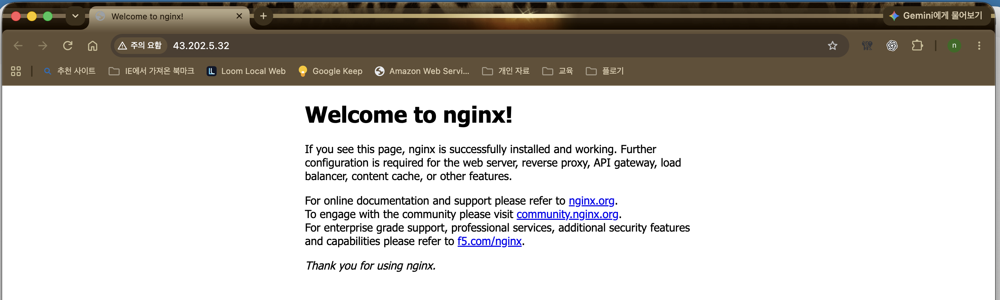

**EC2 퍼블릭 IP 43.202.5.32 확인**

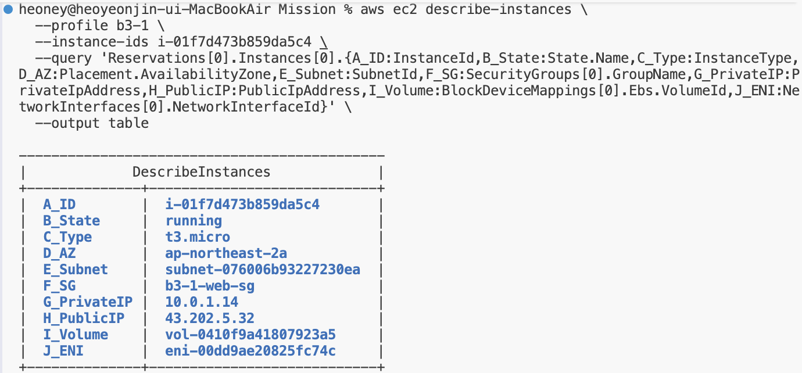

**서버 쪽 기록: Nginx 접속 로그에 남은 Mac Chrome 요청 (IP 가림)**

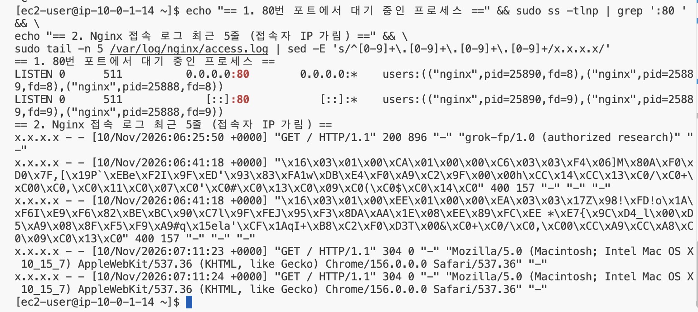

#### 실습 근거

**퍼블릭 IP 확인** · [실습 로그](practice-session.log) 175–190행

```bash
$ aws ec2 describe-instances \
    --profile b3-1 \
    --instance-ids i-01f7d473b859da5c4 \
    --query 'Reservations[0].Instances[0].{A_ID:InstanceId,B_State:State.Name,C_Type:InstanceType,D_AZ:Placement.AvailabilityZone,E_Subnet:SubnetId,F_SG:SecurityGroups[0].GroupName,G_PrivateIP:PrivateIpAddress,H_PublicIP:PublicIpAddress,I_Volume:BlockDeviceMappings[0].Ebs.VolumeId,J_ENI:NetworkInterfaces[0].NetworkInterfaceId}' \
    --output table
|  A_ID        |  i-01f7d473b859da5c4       |
|  B_State     |  running                   |
|  C_Type      |  t3.micro                  |
|  D_AZ        |  ap-northeast-2a           |
|  E_Subnet    |  subnet-076006b93227230ea  |
|  F_SG        |  b3-1-web-sg               |
|  G_PrivateIP |  10.0.1.14                 |
|  H_PublicIP  |  43.202.5.32               |
|  I_Volume    |  vol-0410f9a41807923a5     |
|  J_ENI       |  eni-00dd9ae20825fc74c     |
# 캡처: docs/screenshots/ec2-instance.png
```

**서버 쪽 기록: 브라우저 요청 도착** · [실습 로그](practice-session.log) 269–271행

```bash
x.x.x.x - - [10/Nov/2026:07:11:23 +0000] "GET / HTTP/1.1" 304 0 "-" "Mozilla/5.0 (Macintosh; Intel Mac OS X 10_15_7) AppleWebKit/537.36 (KHTML, like Gecko) Chrome/156.0.0.0 Safari/537.36" "-"
x.x.x.x - - [10/Nov/2026:07:11:24 +0000] "GET / HTTP/1.1" 304 0 "-" "Mozilla/5.0 (Macintosh; Intel Mac OS X 10_15_7) AppleWebKit/537.36 (KHTML, like Gecko) Chrome/156.0.0.0 Safari/537.36" "-"
# 해석: 07:11 UTC(16:11 KST) 두 줄이 내 Mac 브라우저 새로고침(304 = 캐시 확인 응답). 06:25의 grok-fp, 06:41의 TLS 바이트(400)는 외부 자동 스캐너.
```

- **README의 검증 방식 기록**: [README.md](../README.md)의 해당 부분 (5–13행)


### 1-5. 리소스 정리 체크리스트에서 최소 5종(EC2/EBS/EIP/IGW/VPC) 정리 완료를 확인할 수 있는가?

> **답변 요점** 예. docs/cleanup-checklist.md에 정리 전 목록(태그 기준 9개), 삭제 순서와 결과, 정리 후 조회(EC2 terminated, EBS·EIP·IGW·VPC 등 모두 0)를 기록했다. EIP·NAT·ALB·RDS는 만들지 않았고(정책상 권한 없음) 정리 후 조회로 남은 것이 없음을 확인했다.

#### 증빙 캡처

**정리 전: 태그 기준 리소스 9개와 EBS 8 GiB 상태**

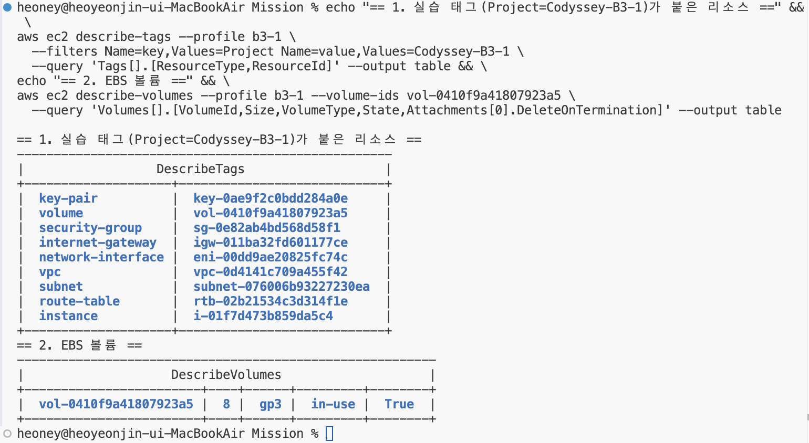

**정리 후: EC2 terminated, 나머지 리소스 모두 0**

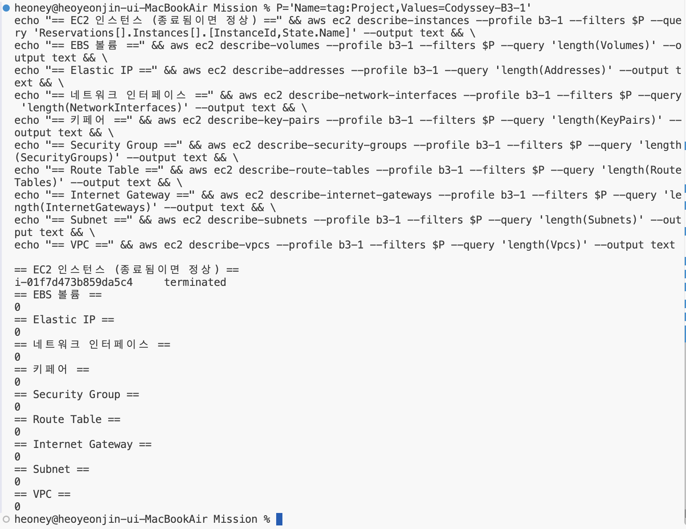

**정리 후: http://43.202.5.32 접속 시간 초과 (서비스 완전 종료)**

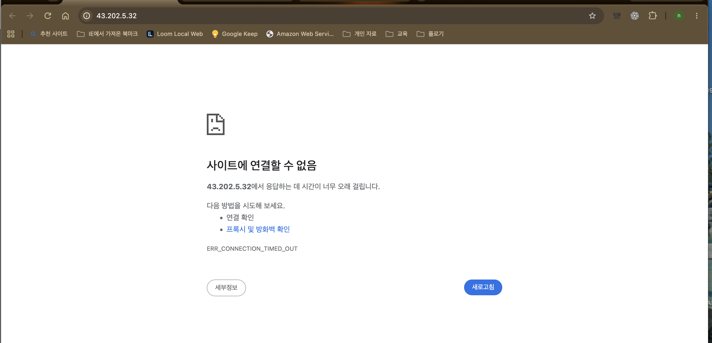

#### 실습 근거

**정리 전: 태그로 찾은 리소스 9개** · [실습 로그](practice-session.log) 241–252행

```bash
$ aws ec2 describe-tags --profile b3-1 \
    --filters Name=key,Values=Project Name=value,Values=Codyssey-B3-1 \
    --query 'Tags[].[ResourceType,ResourceId]' --output table
|  key-pair           |  key-0ae9f2c0bdd284a0e      |
|  volume             |  vol-0410f9a41807923a5      |
|  security-group     |  sg-0e82ab4bd568d58f1       |
|  internet-gateway   |  igw-011ba32fd601177ce      |
|  network-interface  |  eni-00dd9ae20825fc74c      |
|  vpc                |  vpc-0d4141c709a455f42      |
|  subnet             |  subnet-076006b93227230ea   |
|  route-table        |  rtb-02b21534c3d314f1e      |
|  instance           |  i-01f7d473b859da5c4        |
```

**삭제 명령: EC2 → 키페어·SG → Route Table → IGW → Subnet → VPC** · [실습 로그](practice-session.log) 275–305행

```bash
$ aws ec2 terminate-instances --profile b3-1 \
    --instance-ids i-01f7d473b859da5c4 \
    --query 'TerminatingInstances[].[InstanceId,PreviousState.Name,CurrentState.Name]' \
    --output table
|  i-01f7d473b859da5c4 |  running |  shutting-down  |
$ aws ec2 wait instance-terminated --profile b3-1 --instance-ids i-01f7d473b859da5c4 && echo "종료 완료"
종료 완료
$ aws ec2 delete-key-pair --profile b3-1 --key-name b3-1-key
{
    "Return": true,
    "KeyPairId": "key-0ae9f2c0bdd284a0e"
}
$ aws ec2 delete-security-group --profile b3-1 --group-id sg-0e82ab4bd568d58f1
{
    "Return": true,
    "GroupId": "sg-0e82ab4bd568d58f1"
}
$ aws ec2 disassociate-route-table --profile b3-1 --association-id rtbassoc-0fa8d7b66366482b8
# (보고) 출력 없음 = 성공
$ aws ec2 delete-route-table --profile b3-1 --route-table-id rtb-02b21534c3d314f1e
# (보고) 출력 없음 = 성공
$ aws ec2 detach-internet-gateway --profile b3-1 \
    --internet-gateway-id igw-011ba32fd601177ce \
    --vpc-id vpc-0d4141c709a455f42
# (보고) 출력 없음 = 성공
$ aws ec2 delete-internet-gateway --profile b3-1 --internet-gateway-id igw-011ba32fd601177ce
# (보고) 출력 없음 = 성공
$ aws ec2 delete-subnet --profile b3-1 --subnet-id subnet-076006b93227230ea
# (보고) 출력 없음 = 성공
$ aws ec2 delete-vpc --profile b3-1 --vpc-id vpc-0d4141c709a455f42
# (보고) 출력 없음 = 성공
```

**정리 후: 종류별 남은 개수** · [실습 로그](practice-session.log) 308–329행

```bash
$ P='Name=tag:Project,Values=Codyssey-B3-1'
$ aws ec2 describe-instances --profile b3-1 --filters $P --query 'Reservations[].Instances[].[InstanceId,State.Name]' --output text
i-01f7d473b859da5c4     terminated
$ aws ec2 describe-volumes --profile b3-1 --filters $P --query 'length(Volumes)' --output text
0
$ aws ec2 describe-addresses --profile b3-1 --query 'length(Addresses)' --output text
0
$ aws ec2 describe-network-interfaces --profile b3-1 --filters $P --query 'length(NetworkInterfaces)' --output text
0
$ aws ec2 describe-key-pairs --profile b3-1 --filters $P --query 'length(KeyPairs)' --output text
0
$ aws ec2 describe-security-groups --profile b3-1 --filters $P --query 'length(SecurityGroups)' --output text
0
$ aws ec2 describe-route-tables --profile b3-1 --filters $P --query 'length(RouteTables)' --output text
0
$ aws ec2 describe-internet-gateways --profile b3-1 --filters $P --query 'length(InternetGateways)' --output text
0
$ aws ec2 describe-subnets --profile b3-1 --filters $P --query 'length(Subnets)' --output text
0
$ aws ec2 describe-vpcs --profile b3-1 --filters $P --query 'length(Vpcs)' --output text
0
# 실제로는 위 명령들을 echo 머리말과 &&로 이어 한 번에 실행했다. 캡처: docs/screenshots/cleanup-result.png
```


---

## 항목 2 · 구성 설명

### 2-1. 외부 → IGW → Subnet → EC2로 이어지는 네트워크 흐름을 다이어그램 기준으로 설명할 수 있는가?

> **답변 요점** ① 브라우저가 퍼블릭 IP 43.202.5.32로 HTTP 80 요청 → ② VPC에 연결된 IGW가 퍼블릭 IP를 사설 IP 10.0.1.14로 바꿔 전달, Subnet의 Route Table에 0.0.0.0/0 → IGW가 있어 응답도 IGW로 나감 → ③ EC2 ENI에 적용된 SG가 80을 허용 → Nginx 응답.

#### 증빙 캡처

**아키텍처 다이어그램 (①~③ 인바운드 · ④⑤ 아웃바운드)**

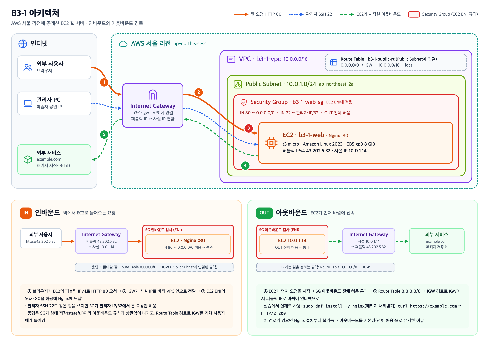

#### 실습 근거

**② IGW를 VPC에 연결** · [실습 로그](practice-session.log) 56–64행

```bash
$ aws ec2 attach-internet-gateway \
    --profile b3-1 \
    --internet-gateway-id igw-011ba32fd601177ce \
    --vpc-id vpc-0d4141c709a455f42
$ aws ec2 describe-internet-gateways --profile b3-1 \
    --internet-gateway-ids igw-011ba32fd601177ce \
    --query 'InternetGateways[].Attachments[].[VpcId,State]' \
    --output table
# (보고) vpc-0d4141c709a455f42 | available
```

**② 0.0.0.0/0 → IGW 경로** · [실습 로그](practice-session.log) 74–81행

```bash
$ aws ec2 create-route \
    --profile b3-1 \
    --route-table-id rtb-02b21534c3d314f1e \
    --destination-cidr-block 0.0.0.0/0 \
    --gateway-id igw-011ba32fd601177ce
{
    "Return": true
}
```

**③ SG 인바운드 80** · [실습 로그](practice-session.log) 105–111행

```bash
$ aws ec2 authorize-security-group-ingress \
    --profile b3-1 \
    --group-id sg-0e82ab4bd568d58f1 \
    --ip-permissions 'IpProtocol=tcp,FromPort=80,ToPort=80,IpRanges=[{CidrIp=0.0.0.0/0,Description="HTTP from anywhere"}]' \
    --query 'SecurityGroupRules[].[IsEgress,IpProtocol,FromPort,ToPort,CidrIpv4]' \
    --output table
|  False|  tcp |  80 |  80 |  0.0.0.0/0   |
```


### 2-2. 보안 그룹 규칙을 어떤 기준으로 최소화했는지(허용/미허용 포트) 설명할 수 있는가?

> **답변 요점** 기준은 '서비스에 꼭 필요한 포트만, 꼭 필요한 대상에게만'이다. 허용: 80(누구나, 서비스 목적), 22(내 IP/32만, 관리 목적). 미허용: 443(HTTPS 미적용), DB 포트(DB 없음), 그 밖의 전 포트. 아웃바운드는 패키지 설치를 위해 기본 전체 허용을 유지했다.

#### 증빙 캡처

**허용한 규칙 3줄 (이 외 포트는 모두 차단)**


#### 실습 근거

**최종 SG 규칙 3줄** · [실습 로그](practice-session.log) 119–127행

```bash
$ aws ec2 describe-security-group-rules \
    --profile b3-1 \
    --filters Name=group-id,Values=sg-0e82ab4bd568d58f1 \
    --query 'SecurityGroupRules[].[IsEgress,IpProtocol,FromPort,ToPort,CidrIpv4]' \
    --output table
|  True |  -1  |  -1 |  -1 |  0.0.0.0/0           |
|  False|  tcp |  80 |  80 |  0.0.0.0/0           |
|  False|  tcp |  22 |  22 |  x.x.x.x/32   |
# 캡처: docs/screenshots/sg-rules-masked.png (IP 가림 · 원본은 mission_docs/private-screenshots/sg-rules.png, 제출 제외)
```

- **README의 최소화 설명**: [README.md](../README.md)의 해당 부분 (78–80행)


### 2-3. 외부 접속 검증을 A 또는 B 중 무엇으로 선택했고, 그 선택을 위해 무엇을 어떻게 구성했는지 설명할 수 있는가?

> **답변 요점** A(브라우저 접속)를 골랐다. 추가 설정 없이 Nginx 기본 페이지로 검증할 수 있어서다. 이를 위해 퍼블릭 IPv4 자동 할당, IGW 연결, 0.0.0.0/0 → IGW 경로, SG 80 허용, Nginx 설치·실행의 다섯 가지를 갖추고, localhost 200 → 브라우저 순서로 확인했다.

#### 증빙 캡처

**퍼블릭 IP를 받은 EC2**


**서버 안 localhost 200 먼저 확인**


**브라우저 외부 접속 확인**


#### 실습 근거

**퍼블릭 IPv4를 받도록 EC2 생성** · [실습 로그](practice-session.log) 150–165행

```bash
$ aws ec2 run-instances \
    --profile b3-1 \
    --image-id ami-0b8d35c42668c50d7 \
    --instance-type t3.micro \
    --count 1 \
    --key-name b3-1-key \
    --network-interfaces 'DeviceIndex=0,SubnetId=subnet-076006b93227230ea,Groups=sg-0e82ab4bd568d58f1,AssociatePublicIpAddress=true' \
    --block-device-mappings 'DeviceName=/dev/xvda,Ebs={VolumeSize=8,VolumeType=gp3,DeleteOnTermination=true}' \
    --credit-specification CpuCredits=standard \
    --tag-specifications \
      'ResourceType=instance,Tags=[{Key=Name,Value=b3-1-web},{Key=Project,Value=Codyssey-B3-1},{Key=Owner,Value=Yeonjin_IAM}]' \
      'ResourceType=volume,Tags=[{Key=Name,Value=b3-1-web-root},{Key=Project,Value=Codyssey-B3-1},{Key=Owner,Value=Yeonjin_IAM}]' \
      'ResourceType=network-interface,Tags=[{Key=Name,Value=b3-1-web-eni},{Key=Project,Value=Codyssey-B3-1},{Key=Owner,Value=Yeonjin_IAM}]' \
    --query 'Instances[0].[InstanceId,State.Name,InstanceType,PrivateIpAddress]' \
    --output text
i-01f7d473b859da5c4     pending t3.micro        10.0.1.14
```

**웹 서버 준비와 내부 확인** · [실습 로그](practice-session.log) 201–215행

```bash
[ec2-user@ip-10-0-1-14 ~]$ sudo dnf install -y nginx
# (보고) 설치 목록 출력 후 마지막 줄 Complete!
[ec2-user@ip-10-0-1-14 ~]$ sudo systemctl enable --now nginx
[ec2-user@ip-10-0-1-14 ~]$ systemctl is-active nginx
# (보고) active
[ec2-user@ip-10-0-1-14 ~]$ echo "== 1. nginx 상태 ==" && systemctl is-active nginx && \
echo "== 2. curl http://localhost ==" && curl -sI http://localhost | head -1 && \
echo "== 3. curl https://example.com (아웃바운드) ==" && curl -sI https://example.com | head -1
== 1. nginx 상태 ==
active
== 2. curl http://localhost ==
HTTP/1.1 200 OK
== 3. curl https://example.com (아웃바운드) ==
HTTP/2 200
# 캡처: docs/screenshots/server-local-check.png
```

**브라우저 접속 결과** · [실습 로그](practice-session.log) 217–219행

```bash
## 8. 외부 접속 (방식 A)
# 브라우저 주소창에 http://43.202.5.32 입력 → "Welcome to nginx!" 페이지 표시 (주소창: 주의 요함 43.202.5.32)
# 캡처: docs/screenshots/external-access.png
```


### 2-4. 실습 리소스를 추적/정리하기 위해 어떤 기준(태그, 이름 규칙, 체크리스트)을 사용했는지 설명할 수 있는가?

> **답변 요점** 세 가지를 썼다. ① 모든 리소스에 Project=Codyssey-B3-1, Owner=Yeonjin_IAM 태그(IAM 정책이 강제, EBS·ENI 포함) ② Name=b3-1-역할 이름 규칙 ③ 생성 직후 유형·ID·정리 방법을 적은 리소스 장부. 정리 때 이 장부를 체크리스트로 쓴다.

#### 증빙 캡처

**태그 Project=Codyssey-B3-1로 찾은 실습 리소스 9개**


#### 실습 근거

**정리 전: 태그로 찾은 리소스 9개** · [실습 로그](practice-session.log) 241–252행

```bash
$ aws ec2 describe-tags --profile b3-1 \
    --filters Name=key,Values=Project Name=value,Values=Codyssey-B3-1 \
    --query 'Tags[].[ResourceType,ResourceId]' --output table
|  key-pair           |  key-0ae9f2c0bdd284a0e      |
|  volume             |  vol-0410f9a41807923a5      |
|  security-group     |  sg-0e82ab4bd568d58f1       |
|  internet-gateway   |  igw-011ba32fd601177ce      |
|  network-interface  |  eni-00dd9ae20825fc74c      |
|  vpc                |  vpc-0d4141c709a455f42      |
|  subnet             |  subnet-076006b93227230ea   |
|  route-table        |  rtb-02b21534c3d314f1e      |
|  instance           |  i-01f7d473b859da5c4        |
```

**EC2와 함께 생기는 리소스 3종의 태그** · [실습 로그](practice-session.log) 159–162행

```bash
    --tag-specifications \
      'ResourceType=instance,Tags=[{Key=Name,Value=b3-1-web},{Key=Project,Value=Codyssey-B3-1},{Key=Owner,Value=Yeonjin_IAM}]' \
      'ResourceType=volume,Tags=[{Key=Name,Value=b3-1-web-root},{Key=Project,Value=Codyssey-B3-1},{Key=Owner,Value=Yeonjin_IAM}]' \
      'ResourceType=network-interface,Tags=[{Key=Name,Value=b3-1-web-eni},{Key=Project,Value=Codyssey-B3-1},{Key=Owner,Value=Yeonjin_IAM}]' \
```

**태그를 강제하는 정책 조건** · IAM 정책 [iam-policy.json](iam-policy.json) 63–86행

```json
    {
      "Sid": "CreateTaggedLabResources",
      "Effect": "Allow",
      "Action": [
        "ec2:CreateSubnet",
        "ec2:CreateRouteTable",
        "ec2:CreateInternetGateway",
        "ec2:CreateSecurityGroup",
        "ec2:CreateKeyPair"
      ],
      "Resource": [
        "arn:aws:ec2:ap-northeast-2:503440159666:subnet/*",
        "arn:aws:ec2:ap-northeast-2:503440159666:route-table/*",
        "arn:aws:ec2:ap-northeast-2:503440159666:internet-gateway/*",
        "arn:aws:ec2:ap-northeast-2:503440159666:security-group/*",
        "arn:aws:ec2:ap-northeast-2:503440159666:key-pair/*"
      ],
      "Condition": {
        "StringEquals": {
          "aws:RequestTag/Project": "Codyssey-B3-1",
          "aws:RequestTag/Owner": "Yeonjin_IAM"
        }
      }
    },
```

- **README의 태그 규칙**: [README.md](../README.md)의 해당 부분 (64–64행)


---

## 항목 3 · 원리 설명

### 3-1. Public Subnet Route Table의 기본 경로(0.0.0.0/0 → IGW)가 필요한 이유를 설명할 수 있는가?

> **답변 요점** VPC를 만들면 Route Table에는 10.0.0.0/16 → local만 있어 VPC 안끼리만 통신한다. 사용자 IP 같은 인터넷 주소는 local에 해당하지 않으므로 0.0.0.0/0 → IGW가 없으면 응답 패킷이 갈 곳이 없다. 이 한 줄이 Public과 Private Subnet을 가르는 기준이다.

#### 증빙 캡처

**Route Table 경로 두 줄과 Subnet 연결**

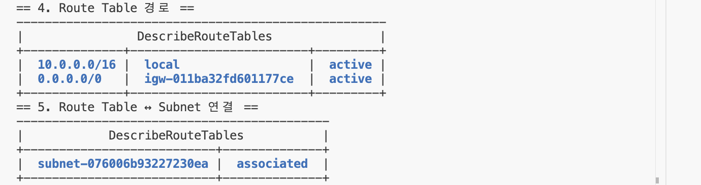

#### 실습 근거

**새 Route Table과 기본 경로** · [실습 로그](practice-session.log) 67–81행

```bash
$ aws ec2 create-route-table \
    --profile b3-1 \
    --vpc-id vpc-0d4141c709a455f42 \
    --tag-specifications 'ResourceType=route-table,Tags=[{Key=Name,Value=b3-1-public-rt},{Key=Project,Value=Codyssey-B3-1},{Key=Owner,Value=Yeonjin_IAM}]' \
    --query 'RouteTable.RouteTableId' \
    --output text
rtb-02b21534c3d314f1e
$ aws ec2 create-route \
    --profile b3-1 \
    --route-table-id rtb-02b21534c3d314f1e \
    --destination-cidr-block 0.0.0.0/0 \
    --gateway-id igw-011ba32fd601177ce
{
    "Return": true
}
```

**최종 경로 두 줄** · [실습 로그](practice-session.log) 231–237행

```bash
$ aws ec2 describe-route-tables --profile b3-1 --route-table-ids rtb-02b21534c3d314f1e \
    --query 'RouteTables[].Routes[].[DestinationCidrBlock,GatewayId,State]' --output table
|  10.0.0.0/16 |  local                   |  active |
|  0.0.0.0/0   |  igw-011ba32fd601177ce   |  active |
$ aws ec2 describe-route-tables --profile b3-1 --route-table-ids rtb-02b21534c3d314f1e \
    --query 'RouteTables[].Associations[].[SubnetId,AssociationState.State]' --output table
|  subnet-076006b93227230ea |  associated  |
```


### 3-2. Security Group과 IAM의 책임 범위 차이를 설명하고, 최소 권한이 왜 필요한지 설명할 수 있는가?

> **답변 요점** SG는 '어떤 네트워크 트래픽이 EC2에 닿는가'(포트·출발지, ENI에 적용)를, IAM은 '누가 어떤 AWS 작업을 할 수 있는가'(API·리소스·조건, 사용자/Role에 적용)를 정한다. 최소 권한은 유출·실수 시 피해 범위를 줄이며, 이번 실습은 정책 범위만으로 모든 작업을 권한 오류 없이 끝냈다.

#### 증빙 캡처

**IAM 사용자 Yeonjin_IAM으로 작업 (루트 아님)**

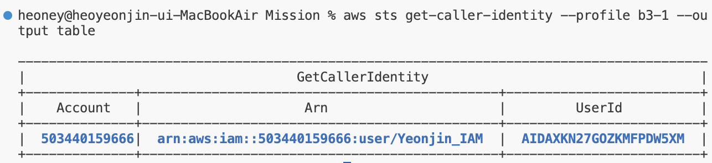

**SG는 포트·출발지 규칙**


#### 실습 근거

**IAM: 공식 이미지로만 생성** · IAM 정책 [iam-policy.json](iam-policy.json) 103–116행

```json
    {
      "Sid": "LaunchFromAmazonImages",
      "Effect": "Allow",
      "Action": [
        "ec2:RunInstances"
      ],
      "Resource": "arn:aws:ec2:ap-northeast-2::image/ami-*",
      "Condition": {
        "StringEquals": {
          "ec2:Owner": "amazon",
          "ec2:RootDeviceType": "ebs"
        }
      }
    },
```

**IAM: t3.micro·태그 필수** · IAM 정책 [iam-policy.json](iam-policy.json) 135–150행

```json
    {
      "Sid": "LaunchTaggedMicroInstances",
      "Effect": "Allow",
      "Action": [
        "ec2:RunInstances"
      ],
      "Resource": "arn:aws:ec2:ap-northeast-2:503440159666:instance/*",
      "Condition": {
        "StringEquals": {
          "aws:RequestTag/Project": "Codyssey-B3-1",
          "aws:RequestTag/Owner": "Yeonjin_IAM",
          "ec2:InstanceType": "t3.micro",
          "ec2:Tenancy": "default"
        }
      }
    },
```

**SG: 트래픽 규칙** · [실습 로그](practice-session.log) 119–126행

```bash
$ aws ec2 describe-security-group-rules \
    --profile b3-1 \
    --filters Name=group-id,Values=sg-0e82ab4bd568d58f1 \
    --query 'SecurityGroupRules[].[IsEgress,IpProtocol,FromPort,ToPort,CidrIpv4]' \
    --output table
|  True |  -1  |  -1 |  -1 |  0.0.0.0/0           |
|  False|  tcp |  80 |  80 |  0.0.0.0/0           |
|  False|  tcp |  22 |  22 |  x.x.x.x/32   |
```


### 3-3. SSH(22) 또는 DB 포트를 0.0.0.0/0로 열면 안 되는 이유와 대안을 설명할 수 있는가?

> **답변 요점** 인터넷에는 22·3306 같은 관리 포트를 자동으로 찾는 봇이 상시 있어, 열리자마자 대입·취약점 공격을 받는다. 뚫리면 서버·데이터 전체가 위험하다. 대안은 출발지를 내 IP/32로 제한(실습), SSM Session Manager로 22 미개방, Bastion/VPN, DB는 Private Subnet + 웹 서버 SG만 허용(SG 참조)이다.

#### 증빙 캡처

**SSH 22 출발지 /32 제한**


**80번을 연 뒤 찾아온 외부 스캐너 요청 (grok-fp, TLS 시도 400)**


#### 실습 근거

**내 공인 IP 확인** · [실습 로그](practice-session.log) 94–95행

```bash
$ curl -s https://checkip.amazonaws.com
x.x.x.x
```

**22번을 /32로 제한** · [실습 로그](practice-session.log) 112–118행

```bash
$ aws ec2 authorize-security-group-ingress \
    --profile b3-1 \
    --group-id sg-0e82ab4bd568d58f1 \
    --ip-permissions 'IpProtocol=tcp,FromPort=22,ToPort=22,IpRanges=[{CidrIp=x.x.x.x/32,Description="SSH from my IP only"}]' \
    --query 'SecurityGroupRules[].[IsEgress,IpProtocol,FromPort,ToPort,CidrIpv4]' \
    --output table
|  False|  tcp |  22 |  22 |  x.x.x.x/32   |
```

**80번을 연 뒤 찾아온 외부 스캐너** · [실습 로그](practice-session.log) 266–268행

```bash
x.x.x.x - - [10/Nov/2026:06:25:50 +0000] "GET / HTTP/1.1" 200 896 "-" "grok-fp/1.0 (authorized research)" "-"
# (요약) x.x.x.x - - [10/Nov/2026:06:41:18 +0000] "\x16\x03\x01…(TLS 접속 시도 바이트)…" 400 157 "-" "-" "-"
# (요약) x.x.x.x - - [10/Nov/2026:06:41:18 +0000] "\x16\x03\x01…(TLS 접속 시도 바이트)…" 400 157 "-" "-" "-"
```


### 3-4. 트러블슈팅에서 가설 → 검증 순서를 유지한 이유와, 로그/근거를 어떻게 활용했는지 설명할 수 있는가?

> **답변 요점** 추측으로 바로 조치하면 문제를 키울 수 있어서다. 사례 1에서 생성 명령을 다시 실행했다면 IGW가 중복 생성됐다. 오류 문구 종류(Row 출력 vs UnauthorizedOperation), 오류 분류 코드(ParamValidation = 요청 전 로컬 검사), 오류 위치(column 30, ^), 조회 결과(Attached: 0)를 근거로 가설을 걸렀다.

#### 증빙 캡처

**사례 1: 출력 오류 → 재실행 대신 조회로 검증**

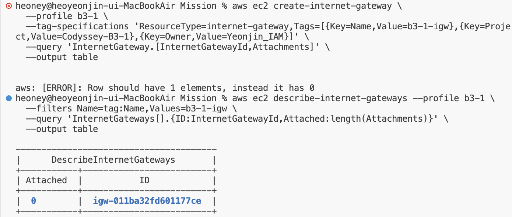

**사례 2: ParamValidation 오류와 위치 표시**

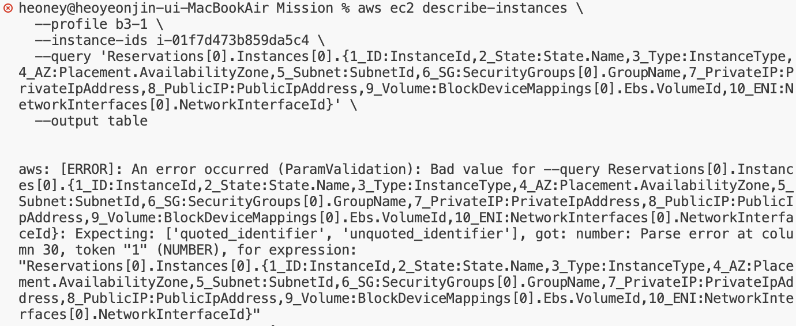

#### 실습 근거

**사례 1: 가설과 판단 근거** · [troubleshooting.md](troubleshooting.md) 27–33행

```markdown
### 가설

1. **생성 실패**: IAM 정책이 요구하는 태그 조건 등을 만족하지 못해 IGW가 만들어지지 않았다.
2. **출력 단계 오류**: IGW는 만들어졌지만, 새 IGW의 `Attachments`가 빈 목록 `[]`이라서 table 형식이 빈 칸을 행으로 그리지 못했다.

오류 문구가 권한 오류(`UnauthorizedOperation`)가 아니라 표의 행(`Row`)과 원소 개수에 관한 내용이라 가설 2를 먼저 의심했습니다. 다만 같은 명령을 다시 실행하면 IGW가 중복으로 생길 수 있으므로, 재실행 대신 조회로 확인하기로 했습니다.

```

**사례 1: 조회로 검증** · [troubleshooting.md](troubleshooting.md) 34–51행

```markdown
### 검증

생성 명령을 반복하지 않고, 이름 태그로 실제 존재 여부와 연결 상태를 조회했습니다. 빈 목록은 `length()`로 바꿔 숫자로 출력했습니다.

```bash
aws ec2 describe-internet-gateways --profile b3-1 \
  --filters Name=tag:Name,Values=b3-1-igw \
  --query 'InternetGateways[].{ID:InternetGatewayId,Attached:length(Attachments)}' \
  --output table
```

```text
| Attached |          ID            |
|    0     | igw-011ba32fd601177ce  |
```

`b3-1-igw`가 정확히 1개 존재하고 아직 어느 VPC에도 연결되지 않았습니다(`Attached: 0`). 가설 2가 맞고 가설 1은 기각됐습니다.

```

**사례 2: 오류 분류와 위치로 검증** · [troubleshooting.md](troubleshooting.md) 97–106행

```markdown
### 가설

1. **인스턴스 또는 권한 문제**: EC2가 아직 준비되지 않았거나, 조회 권한이 없어서 실패했다.
2. **`--query` 문법 오류**: 쿼리 문자열 자체가 JMESPath 문법에 맞지 않는다.

### 검증

- 오류 종류가 `ParamValidation`입니다. 이는 AWS에 요청을 보내기 **전에** CLI가 입력값을 검사하다 실패했다는 뜻입니다. 권한 문제였다면 `UnauthorizedOperation`, 인스턴스 문제였다면 `InvalidInstanceID` 같은 API 응답 오류가 나왔을 것입니다. 따라서 가설 1을 기각했습니다.
- 오류가 가리킨 위치(`column 30`, `token "1" (NUMBER)`)는 `{` 바로 뒤의 `1_ID`입니다. CLI는 그 자리에 식별자(`quoted_identifier` 또는 `unquoted_identifier`)를 기대했는데 숫자가 왔다고 알려 줍니다.
- JMESPath에서 따옴표 없는 식별자는 **영문자나 `_`로 시작**해야 합니다. `1_ID`처럼 숫자로 시작하는 키 이름은 허용되지 않습니다. 가설 2를 확인했습니다.
```


---

## 항목 4 · 응용 설명

### 4-1. 외부 접속이 안 될 때, 어떤 순서로 라우팅 → SG → 퍼블릭 IP/DNS → 서버 프로세스/로그를 점검하는지 설명할 수 있는가?

> **답변 요점** 먼저 서버 안 curl localhost로 서버/네트워크 문제를 가른다. 그다음 ① 라우팅(0.0.0.0/0 → IGW active, Subnet 연결, IGW attach) ② SG(인바운드 80, 출발지, 인스턴스에 연결 여부, 내 IP 변경) ③ 퍼블릭 IP/DNS(할당 여부, 재시작 후 변경, http:// 여부) ④ 서버 프로세스·로그(systemctl status, ss -tlnp, error.log) 순으로 본다.

#### 증빙 캡처

**0단계: 서버 안 localhost 확인**


**1단계: 라우팅 확인**


**2단계: SG 확인**


**3단계: 퍼블릭 IP 확인**


**4단계: 80번 대기 프로세스와 Nginx 접속 로그**


#### 실습 근거

**0단계: 서버 안에서 먼저 가르기** · [실습 로그](practice-session.log) 206–214행

```bash
[ec2-user@ip-10-0-1-14 ~]$ echo "== 1. nginx 상태 ==" && systemctl is-active nginx && \
echo "== 2. curl http://localhost ==" && curl -sI http://localhost | head -1 && \
echo "== 3. curl https://example.com (아웃바운드) ==" && curl -sI https://example.com | head -1
== 1. nginx 상태 ==
active
== 2. curl http://localhost ==
HTTP/1.1 200 OK
== 3. curl https://example.com (아웃바운드) ==
HTTP/2 200
```

**1단계: 라우팅 확인** · [실습 로그](practice-session.log) 228–237행

```bash
$ aws ec2 describe-internet-gateways --profile b3-1 --internet-gateway-ids igw-011ba32fd601177ce \
    --query 'InternetGateways[].Attachments[].[VpcId,State]' --output table
|  vpc-0d4141c709a455f42 |  available   |
$ aws ec2 describe-route-tables --profile b3-1 --route-table-ids rtb-02b21534c3d314f1e \
    --query 'RouteTables[].Routes[].[DestinationCidrBlock,GatewayId,State]' --output table
|  10.0.0.0/16 |  local                   |  active |
|  0.0.0.0/0   |  igw-011ba32fd601177ce   |  active |
$ aws ec2 describe-route-tables --profile b3-1 --route-table-ids rtb-02b21534c3d314f1e \
    --query 'RouteTables[].Associations[].[SubnetId,AssociationState.State]' --output table
|  subnet-076006b93227230ea |  associated  |
```

**2단계: SG 확인** · [실습 로그](practice-session.log) 119–126행

```bash
$ aws ec2 describe-security-group-rules \
    --profile b3-1 \
    --filters Name=group-id,Values=sg-0e82ab4bd568d58f1 \
    --query 'SecurityGroupRules[].[IsEgress,IpProtocol,FromPort,ToPort,CidrIpv4]' \
    --output table
|  True |  -1  |  -1 |  -1 |  0.0.0.0/0           |
|  False|  tcp |  80 |  80 |  0.0.0.0/0           |
|  False|  tcp |  22 |  22 |  x.x.x.x/32   |
```

**3단계: 퍼블릭 IP 확인** · [실습 로그](practice-session.log) 180–189행

```bash
|  A_ID        |  i-01f7d473b859da5c4       |
|  B_State     |  running                   |
|  C_Type      |  t3.micro                  |
|  D_AZ        |  ap-northeast-2a           |
|  E_Subnet    |  subnet-076006b93227230ea  |
|  F_SG        |  b3-1-web-sg               |
|  G_PrivateIP |  10.0.1.14                 |
|  H_PublicIP  |  43.202.5.32               |
|  I_Volume    |  vol-0410f9a41807923a5     |
|  J_ENI       |  eni-00dd9ae20825fc74c     |
```

**4단계: 80번에서 대기 중인 프로세스와 접속 로그** · [실습 로그](practice-session.log) 259–271행

```bash
[ec2-user@ip-10-0-1-14 ~]$ echo "== 1. 80번 포트에서 대기 중인 프로세스 ==" && sudo ss -tlnp | grep ':80 ' && \
echo "== 2. Nginx 접속 로그 최근 5줄 (접속자 IP 가림) ==" && \
sudo tail -n 5 /var/log/nginx/access.log | sed -E 's/^[0-9]+\.[0-9]+\.[0-9]+\.[0-9]+/x.x.x.x/'
== 1. 80번 포트에서 대기 중인 프로세스 ==
LISTEN 0      511          0.0.0.0:80        0.0.0.0:*    users:(("nginx",pid=25890,fd=8),("nginx",pid=25889,fd=8),("nginx",pid=25888,fd=8))
LISTEN 0      511             [::]:80           [::]:*    users:(("nginx",pid=25890,fd=9),("nginx",pid=25889,fd=9),("nginx",pid=25888,fd=9))
== 2. Nginx 접속 로그 최근 5줄 (접속자 IP 가림) ==
x.x.x.x - - [10/Nov/2026:06:25:50 +0000] "GET / HTTP/1.1" 200 896 "-" "grok-fp/1.0 (authorized research)" "-"
# (요약) x.x.x.x - - [10/Nov/2026:06:41:18 +0000] "\x16\x03\x01…(TLS 접속 시도 바이트)…" 400 157 "-" "-" "-"
# (요약) x.x.x.x - - [10/Nov/2026:06:41:18 +0000] "\x16\x03\x01…(TLS 접속 시도 바이트)…" 400 157 "-" "-" "-"
x.x.x.x - - [10/Nov/2026:07:11:23 +0000] "GET / HTTP/1.1" 304 0 "-" "Mozilla/5.0 (Macintosh; Intel Mac OS X 10_15_7) AppleWebKit/537.36 (KHTML, like Gecko) Chrome/156.0.0.0 Safari/537.36" "-"
x.x.x.x - - [10/Nov/2026:07:11:24 +0000] "GET / HTTP/1.1" 304 0 "-" "Mozilla/5.0 (Macintosh; Intel Mac OS X 10_15_7) AppleWebKit/537.36 (KHTML, like Gecko) Chrome/156.0.0.0 Safari/537.36" "-"
# 해석: 07:11 UTC(16:11 KST) 두 줄이 내 Mac 브라우저 새로고침(304 = 캐시 확인 응답). 06:25의 grok-fp, 06:41의 TLS 바이트(400)는 외부 자동 스캐너.
```


### 4-2. IAM 권한이 부족해 작업이 실패했다면, 권한을 무작정 올리지 않고 어떤 방식으로 필요한 최소 범위를 찾아갈지 설명할 수 있는가?

> **답변 요점** 오류에서 거부된 Action·Resource ARN·조건을 읽고(EC2는 decode-authorization-message로 해독), 그 Action 하나를 그 Resource에 필요한 조건과 함께만 추가해 정책 새 버전으로 반영한다. 실습에서는 AccessDenied에 표시된 계정 번호로 정책 ARN의 잘못된 계정 번호를 고쳤고, ImportKeyPair를 CreateKeyPair로 교체했다.

#### 증빙 캡처

**권한을 평가받는 주체 (IAM 사용자)**


#### 실습 근거

**계정 번호까지 지정한 Resource ARN** · IAM 정책 [iam-policy.json](iam-policy.json) 63–86행

```json
    {
      "Sid": "CreateTaggedLabResources",
      "Effect": "Allow",
      "Action": [
        "ec2:CreateSubnet",
        "ec2:CreateRouteTable",
        "ec2:CreateInternetGateway",
        "ec2:CreateSecurityGroup",
        "ec2:CreateKeyPair"
      ],
      "Resource": [
        "arn:aws:ec2:ap-northeast-2:503440159666:subnet/*",
        "arn:aws:ec2:ap-northeast-2:503440159666:route-table/*",
        "arn:aws:ec2:ap-northeast-2:503440159666:internet-gateway/*",
        "arn:aws:ec2:ap-northeast-2:503440159666:security-group/*",
        "arn:aws:ec2:ap-northeast-2:503440159666:key-pair/*"
      ],
      "Condition": {
        "StringEquals": {
          "aws:RequestTag/Project": "Codyssey-B3-1",
          "aws:RequestTag/Owner": "Yeonjin_IAM"
        }
      }
    },
```

**현재 실행 주체** · [실습 로그](practice-session.log) 9–14행

```bash
$ aws login --profile b3-1
# (보고) 브라우저에서 IAM 사용자 Yeonjin_IAM으로 로그인
$ aws sts get-caller-identity --profile b3-1 --output table
|  Account      |  Arn                                          |  UserId                 |
|  503440159666 |  arn:aws:iam::503440159666:user/Yeonjin_IAM   |  AIDAXKN27GOZKMFPDW5XM  |
# 캡처: docs/screenshots/iam-identity.png
```


### 4-3. 트래픽이 늘어 인스턴스를 2대로 늘려야 한다면, 현재 구조에서 무엇이 병목이며 어떤 구성요소(ALB 등)를 추가할지 설명할 수 있는가?

> **답변 요점** 지금은 EC2 1대가 단일 장애점이고 처리량 한계(t3.micro), AZ도 2a 하나, 사용자가 EC2 IP로 직접 접속해 나눌 방법이 없다. 서로 다른 AZ에 Subnet 2개, ALB(DNS 이름 하나로 접속) + Target Group 헬스 체크, EC2 2대(권장: Private Subnet + NAT), SG 체인(ALB SG 80 ← 전체, EC2 SG 80 ← ALB SG), Auto Scaling Group을 추가한다.

#### 증빙 캡처

**현재 구조: EC2 1대 · AZ 2a 한 곳**


#### 실습 근거

**현재: Subnet 하나·EC2 한 대** · [실습 로그](practice-session.log) 150–158행

```bash
$ aws ec2 run-instances \
    --profile b3-1 \
    --image-id ami-0b8d35c42668c50d7 \
    --instance-type t3.micro \
    --count 1 \
    --key-name b3-1-key \
    --network-interfaces 'DeviceIndex=0,SubnetId=subnet-076006b93227230ea,Groups=sg-0e82ab4bd568d58f1,AssociatePublicIpAddress=true' \
    --block-device-mappings 'DeviceName=/dev/xvda,Ebs={VolumeSize=8,VolumeType=gp3,DeleteOnTermination=true}' \
    --credit-specification CpuCredits=standard \
```

**현재: AZ 2a 한 곳** · [실습 로그](practice-session.log) 180–187행

```bash
|  A_ID        |  i-01f7d473b859da5c4       |
|  B_State     |  running                   |
|  C_Type      |  t3.micro                  |
|  D_AZ        |  ap-northeast-2a           |
|  E_Subnet    |  subnet-076006b93227230ea  |
|  F_SG        |  b3-1-web-sg               |
|  G_PrivateIP |  10.0.1.14                 |
|  H_PublicIP  |  43.202.5.32               |
```


### 4-4. Billing에 예상치 못한 비용이 찍혔다면, 어떤 리소스부터 의심하고 어떻게 추적/정리할지 설명할 수 있는가?

> **답변 요점** 시간당 과금되는 것부터 의심한다: 다른 리전의 EC2, 분리된 EBS·스냅샷, 퍼블릭 IPv4/미연결 EIP, NAT·ALB·RDS, 데이터 전송. Bills의 서비스·리전별 금액 → Cost Explorer의 Usage Type으로 좁히고, Tag Editor로 모든 리전의 Project=Codyssey-B3-1 리소스를 찾아 의존 관계 역순으로 지운다. Budgets 알림으로 예방한다.

#### 증빙 캡처

**정리 후 과금 대상(EC2·EBS·EIP) 잔여 없음**


#### 실습 근거

**생성 단계의 과금 방지 옵션** · [실습 로그](practice-session.log) 157–158행

```bash
    --block-device-mappings 'DeviceName=/dev/xvda,Ebs={VolumeSize=8,VolumeType=gp3,DeleteOnTermination=true}' \
    --credit-specification CpuCredits=standard \
```

**정리 후 잔여 과금 대상 확인** · [실습 로그](practice-session.log) 308–329행

```bash
$ P='Name=tag:Project,Values=Codyssey-B3-1'
$ aws ec2 describe-instances --profile b3-1 --filters $P --query 'Reservations[].Instances[].[InstanceId,State.Name]' --output text
i-01f7d473b859da5c4     terminated
$ aws ec2 describe-volumes --profile b3-1 --filters $P --query 'length(Volumes)' --output text
0
$ aws ec2 describe-addresses --profile b3-1 --query 'length(Addresses)' --output text
0
$ aws ec2 describe-network-interfaces --profile b3-1 --filters $P --query 'length(NetworkInterfaces)' --output text
0
$ aws ec2 describe-key-pairs --profile b3-1 --filters $P --query 'length(KeyPairs)' --output text
0
$ aws ec2 describe-security-groups --profile b3-1 --filters $P --query 'length(SecurityGroups)' --output text
0
$ aws ec2 describe-route-tables --profile b3-1 --filters $P --query 'length(RouteTables)' --output text
0
$ aws ec2 describe-internet-gateways --profile b3-1 --filters $P --query 'length(InternetGateways)' --output text
0
$ aws ec2 describe-subnets --profile b3-1 --filters $P --query 'length(Subnets)' --output text
0
$ aws ec2 describe-vpcs --profile b3-1 --filters $P --query 'length(Vpcs)' --output text
0
# 실제로는 위 명령들을 echo 머리말과 &&로 이어 한 번에 실행했다. 캡처: docs/screenshots/cleanup-result.png
```


---

> 실습 로그 발췌는 실습 중 실제로 실행한 AWS CLI 명령과 출력의 기록([practice-session.log](practice-session.log))에서 가져왔으며, 학습자 공인 IP는 `x.x.x.x`로 가렸습니다. `# (보고)` 줄은 출력 원문 대신 결과를 옮겨 적은 줄이고, 표(`--output table`) 출력은 테두리 줄을 생략했습니다. 원본 화면은 함께 실린 캡처입니다.
