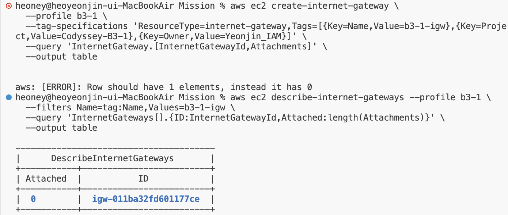
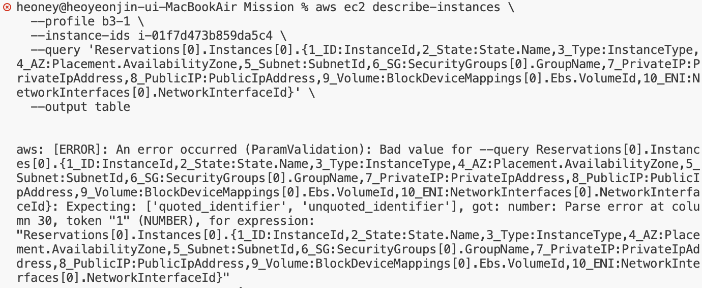
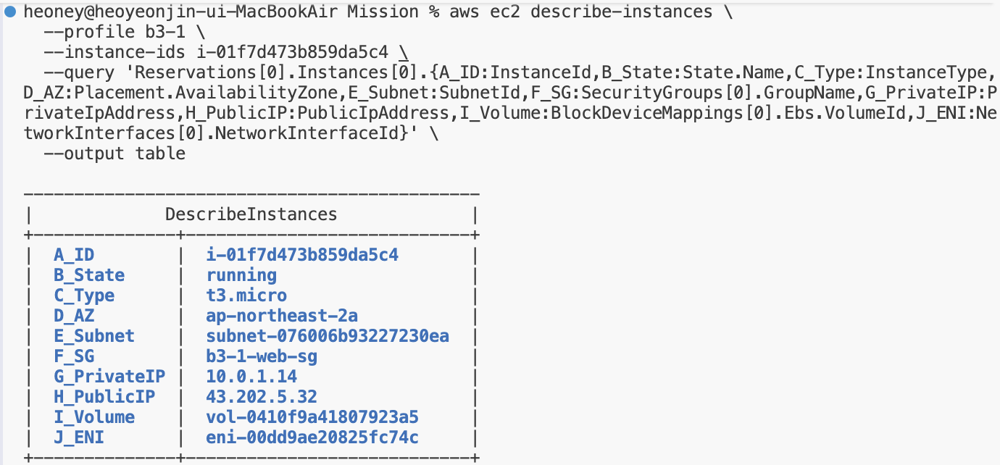

# B3-1 트러블슈팅

실습 중 실제로 발생한 오류 2건을 `증상 → 가설 → 검증 → 조치 → 결과 → 재발 방지` 순서로 기록합니다. 모든 명령은 로컬 Mac의 AWS CLI(`aws-cli/2.38.5`, 프로필 `b3-1`, 리전 `ap-northeast-2`)에서 실행했습니다.

---

## 사례 1. Internet Gateway 생성 직후 출력 오류

### 증상

Internet Gateway를 만들면서 결과를 표로 보려고 `--query`와 `--output table`을 붙였습니다.

```bash
aws ec2 create-internet-gateway \
  --profile b3-1 \
  --tag-specifications 'ResourceType=internet-gateway,Tags=[{Key=Name,Value=b3-1-igw},{Key=Project,Value=Codyssey-B3-1},{Key=Owner,Value=Yeonjin_IAM}]' \
  --query 'InternetGateway.[InternetGatewayId,Attachments]' \
  --output table
```

```text
aws: [ERROR]: Row should have 1 elements, instead it has 0
```

IGW ID가 출력되지 않았고, 생성에 성공했는지 알 수 없었습니다.

### 가설

1. **생성 실패**: IAM 정책이 요구하는 태그 조건 등을 만족하지 못해 IGW가 만들어지지 않았다.
2. **출력 단계 오류**: IGW는 만들어졌지만, 새 IGW의 `Attachments`가 빈 목록 `[]`이라서 table 형식이 빈 칸을 행으로 그리지 못했다.

오류 문구가 권한 오류(`UnauthorizedOperation`)가 아니라 표의 행(`Row`)과 원소 개수에 관한 내용이라 가설 2를 먼저 의심했습니다. 다만 같은 명령을 다시 실행하면 IGW가 중복으로 생길 수 있으므로, 재실행 대신 조회로 확인하기로 했습니다.

### 검증

생성 명령을 반복하지 않고, 이름 태그로 실제 존재 여부와 연결 상태를 조회했습니다. 빈 목록은 `length()`로 바꿔 숫자로 출력했습니다.

```bash
aws ec2 describe-internet-gateways --profile b3-1 \
  --filters Name=tag:Name,Values=b3-1-igw \
  --query 'InternetGateways[].{ID:InternetGatewayId,Attached:length(Attachments)}' \
  --output table
```

```text
| Attached |          ID            |
|    0     | igw-011ba32fd601177ce  |
```

`b3-1-igw`가 정확히 1개 존재하고 아직 어느 VPC에도 연결되지 않았습니다(`Attached: 0`). 가설 2가 맞고 가설 1은 기각됐습니다.



### 조치

IGW를 다시 만들지 않고, 조회로 확인한 ID로 다음 작업을 진행했습니다.

```bash
aws ec2 attach-internet-gateway --profile b3-1 \
  --internet-gateway-id igw-011ba32fd601177ce \
  --vpc-id vpc-0d4141c709a455f42
```

### 결과

IGW 1개만 존재하는 상태로 VPC 연결에 성공했고, 연결 상태 `available`을 확인했습니다. 중복 리소스는 생기지 않았습니다.

### 재발 방지

- 생성 명령 뒤에 오류가 나오면 **다시 실행하기 전에 조회로 실제 상태를 먼저 확인**합니다. 생성 요청은 성공하고 출력만 실패할 수 있습니다.
- 생성 결과에서 빈 목록일 수 있는 필드(`Attachments` 등)는 table 출력 쿼리에 넣지 않습니다. 필요하면 `length()`로 바꾸거나, 생성 명령에서는 ID만 `--output text`로 받습니다. 이후 생성 명령(Route Table, Security Group)은 이 방식으로 실행했습니다.

---

## 사례 2. EC2 상태 조회 `--query` 문법 오류

### 증상

EC2를 생성한 뒤 상태, 퍼블릭 IP, 볼륨 ID를 한 표로 보려고, 표에서 순서가 유지되도록 키 이름 앞에 숫자를 붙여 조회했습니다.

```bash
aws ec2 describe-instances \
  --profile b3-1 \
  --instance-ids i-01f7d473b859da5c4 \
  --query 'Reservations[0].Instances[0].{1_ID:InstanceId,2_State:State.Name,...,10_ENI:NetworkInterfaces[0].NetworkInterfaceId}' \
  --output table
```

```text
aws: [ERROR]: An error occurred (ParamValidation): Bad value for --query Reservations[0].Instances[0].{1_ID:InstanceId,...}:
Expecting: ['quoted_identifier', 'unquoted_identifier'], got: number: Parse error at column 30, token "1" (NUMBER), ...
                               ^
```



### 가설

1. **인스턴스 또는 권한 문제**: EC2가 아직 준비되지 않았거나, 조회 권한이 없어서 실패했다.
2. **`--query` 문법 오류**: 쿼리 문자열 자체가 JMESPath 문법에 맞지 않는다.

### 검증

- 오류 종류가 `ParamValidation`입니다. 이는 AWS에 요청을 보내기 **전에** CLI가 입력값을 검사하다 실패했다는 뜻입니다. 권한 문제였다면 `UnauthorizedOperation`, 인스턴스 문제였다면 `InvalidInstanceID` 같은 API 응답 오류가 나왔을 것입니다. 따라서 가설 1을 기각했습니다.
- 오류가 가리킨 위치(`column 30`, `token "1" (NUMBER)`)는 `{` 바로 뒤의 `1_ID`입니다. CLI는 그 자리에 식별자(`quoted_identifier` 또는 `unquoted_identifier`)를 기대했는데 숫자가 왔다고 알려 줍니다.
- JMESPath에서 따옴표 없는 식별자는 **영문자나 `_`로 시작**해야 합니다. `1_ID`처럼 숫자로 시작하는 키 이름은 허용되지 않습니다. 가설 2를 확인했습니다.

### 조치

키 이름의 숫자 접두어를 알파벳으로 바꿨습니다. table 출력은 키 이름의 알파벳순으로 정렬되므로 원하는 순서도 유지됩니다.

```bash
aws ec2 describe-instances \
  --profile b3-1 \
  --instance-ids i-01f7d473b859da5c4 \
  --query 'Reservations[0].Instances[0].{A_ID:InstanceId,B_State:State.Name,C_Type:InstanceType,D_AZ:Placement.AvailabilityZone,E_Subnet:SubnetId,F_SG:SecurityGroups[0].GroupName,G_PrivateIP:PrivateIpAddress,H_PublicIP:PublicIpAddress,I_Volume:BlockDeviceMappings[0].Ebs.VolumeId,J_ENI:NetworkInterfaces[0].NetworkInterfaceId}' \
  --output table
```

### 결과

조회에 성공해 `running` 상태, `t3.micro`, Public Subnet 배치, 퍼블릭 IP `43.202.5.32`, 볼륨·네트워크 인터페이스 ID를 확인했습니다.



### 재발 방지

- 오류가 나면 **오류 종류부터 구분**합니다. `ParamValidation`은 로컬 입력 문제, `UnauthorizedOperation`은 권한 문제, `Invalid...`는 대상 리소스 문제입니다. 종류에 따라 점검할 곳이 달라집니다.
- `--query`의 키 이름은 영문자로 시작하게 짓습니다. 숫자로 시작해야 한다면 `"1_ID"`처럼 큰따옴표로 감쌉니다.
- 오류 메시지가 가리키는 위치(`column`, `^`)를 먼저 확인해 원인을 좁힙니다.
